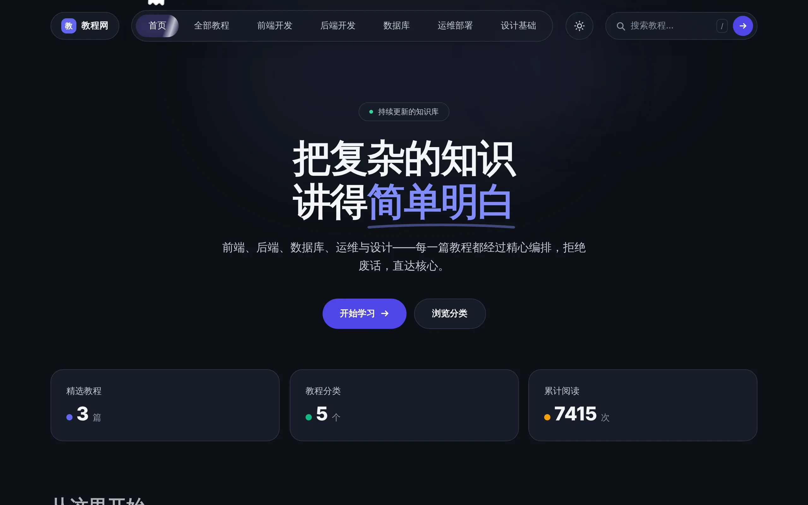
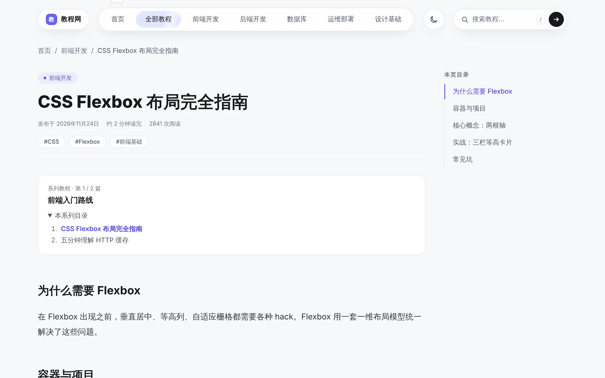
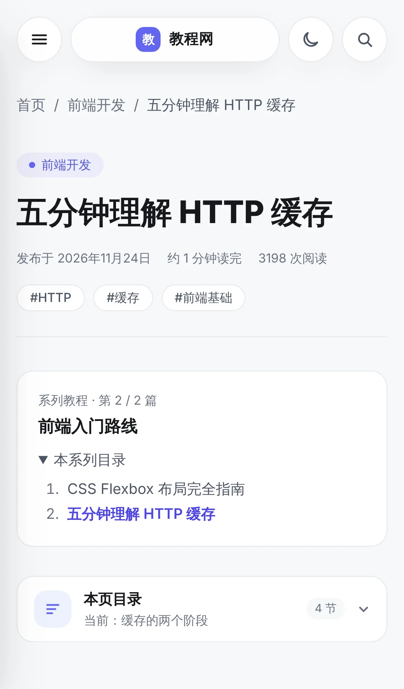
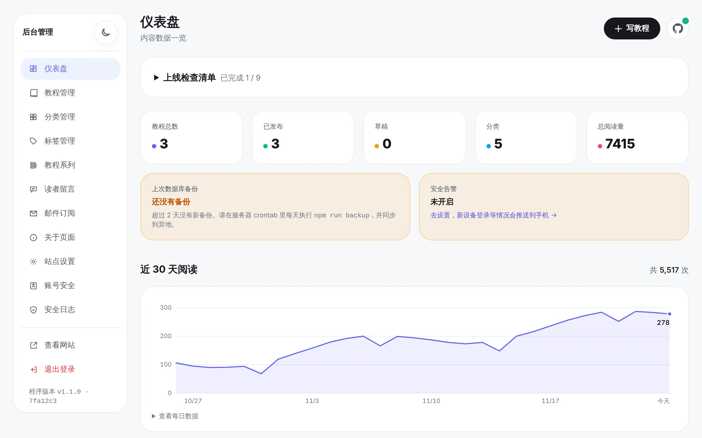
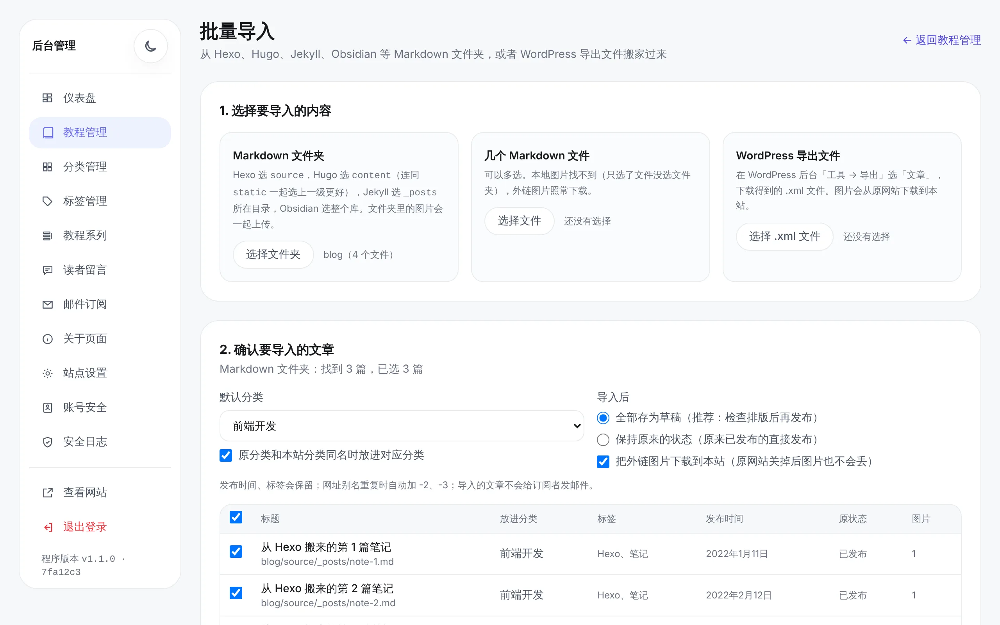

# Tutorial Site

[简体中文](README.md) | **English** | [Русский](README.ru.md) | [日本語](README.ja.md)

An open-source website for illustrated tutorials: a reading site plus an admin for writing and managing content. It runs on a single server (SQLite, no separate database to install). Built with Next.js 16, React 19, Tailwind CSS v4 and Prisma 7. The interface is available in Simplified Chinese, English, Russian and Japanese.

> **Disclaimer**: The tutorials are for lawful personal learning and research only and must not be used for anything illegal or infringing. Users bear all consequences of acting on the content. The content is not guaranteed to be error-free and may be changed at any time; we reserve the right to cooperate with investigations of violations. Visiting the site means you accept this disclaimer.

## Preview

The screenshots show the Chinese interface; switch the site language in the admin to get English.

| Home (light) | Home (dark) |
| --- | --- |
|  |  |

| Article (series contents + page contents) | On a phone |
| --- | --- |
|  |  |

| Dashboard | Bulk import |
| --- | --- |
|  |  |

## Features

- **Reading**: light/dark theme following the system, table of contents, code highlighting with one-click copy, image zoom, reading progress, previous/next and related tutorials, series as "tutorial books" (chapters, read checkmarks, continue reading), tags, full-text search (works for short Chinese queries too), RSS, print layout; animations switch off on low-end devices
- **Writing**: rich-text editor (drag/paste images, tables, code blocks, callouts), draft autosave, revision history, preview, scheduled publishing, cover images, Markdown import/export, bulk migration from Hexo / Hugo / Jekyll / Obsidian / WordPress (keeps dates and images, generates redirect rules for old URLs), media library
- **Audience**: view trends, popular tutorials, completion rate, referring sites, what readers searched for, "Was this helpful?" feedback and reader messages, email subscription for new tutorials, optional third-party comments (Waline / Twikoo / Artalk / Giscus), donation QR codes and a sponsor slot
- **Customization**: site name, logo, favicon, accent color, share image, home page texts, navigation links, footer and site language are all set in the admin, no code changes needed; multiple authors (owner / editor / author)
- **SEO**: sitemap, canonical URLs, structured data, generated share images, search engine verification
- **Security**: two-factor authentication with recovery codes, passkeys, revocable sessions, sign-in rate limiting, HTML allowlist sanitizing, strict CSP, security log and alert push (DingTalk / Feishu / WeCom / Telegram / Webhook), encrypted backups, optional Cloudflare human verification and blocking of AI training crawlers

## Docker deployment

The recommended way. You need Docker and Docker Compose; no Node or build on the server. The image `ghcr.io/vow132/tutorial-site` supports amd64 and arm64:

```bash
git clone https://github.com/vow132/tutorial-site.git && cd tutorial-site
cp .env.example .env
# Edit .env: set SITE_URL to your public address, AUTH_SECRET to the output of openssl rand -base64 48
docker compose up -d
docker compose logs -f app     # ready once you see "Ready"; the log shows the setup URL and setup code
```

Only `docker-compose.yml` and `.env.example` are needed; you don't have to clone the repository.

- All data lives in `./docker-data/` (database, uploaded images, backups) and survives image updates and container rebuilds.
- The port is bound to `127.0.0.1:3000` only. Put Nginx / Caddy with HTTPS in front (see “Security hardening”) and set `TRUST_PROXY=true` in `.env`. With the sample Nginx config, change the `alias` of `/uploads/` to `…/docker-data/uploads/`.
- After editing `.env`, run `docker compose up -d` to apply it. To pin a version, set `TUTORIAL_IMAGE=ghcr.io/vow132/tutorial-site:<version>`.
- Run maintenance commands inside the container as the `node` user: `docker compose exec -u node app npm run backup` (running as root makes the database file owned by root and the site can no longer write to it).
- Scheduled backups: add `17 3 * * * cd /path/to/tutorial-site && docker compose exec -T -u node app npm run backup` to the host's crontab and sync `docker-data` off-site.

Updating: `docker compose pull && docker compose up -d`.

Build the image yourself if you changed the code or can't reach ghcr.io: `docker compose -f docker-compose.yml -f docker-compose.build.yml up -d --build`. The build uses the npmmirror registry by default; set `NPM_REGISTRY=https://registry.npmjs.org/` in `.env` if that is slow for you. After forking, enable Actions in your repository and every push to master builds `ghcr.io/<your-username>/tutorial-site`.

## PM2 deployment

Requires Node.js ≥ 22.12 (24 LTS recommended), npm and PM2:

```bash
git clone https://github.com/vow132/tutorial-site.git && cd tutorial-site
cp .env.example .env.production   # fill it in following the comments
bash deploy.sh                    # install → migrate → seed → build → start with PM2
```

Running `bash deploy.sh` again later keeps the site online and only stops it for the few seconds it takes to migrate the live database.

### Upgrading Node.js

If `node -v` is below 22.12 (using nvm as an example):

```bash
nvm install 24 && nvm alias default 24
npm install -g pm2                          # with nvm, global packages are per Node version
pm2 info 教程网 | grep "exec cwd"          # find the running directory and cd into it
npm rebuild better-sqlite3                  # native module, must be rebuilt after a major Node upgrade
pm2 update                                  # PM2 switches to the new Node and restores the site
```

### One-click update

Sites deployed with PM2 can update from the admin: the dot at the top right of the dashboard turns yellow when a new version is out; click it and enter your password again. The update runs in a separate process (download → install → migrate and build against a copy of the database → back up → switch → health check, with automatic rollback on failure); the site is only down for a few seconds during the switch, and seed data is never run. It requires Linux, a single PM2 process (named `教程网` by default, change it with `SITE_PM2_APP_NAME`), a Git deployment whose `origin` is this repository, and access to GitHub and npm from the server. Set `SITE_AUTO_UPDATE="false"` to turn it off.

After the first one-click update PM2 starts the site from `.updates/active.config.cjs`; restart manually with `pm2 startOrReload .updates/active.config.cjs --update-env`. If you forked and changed the code, merge updates by hand as described in the [customization guide](docs/CUSTOMIZE.md) (Chinese).

## First-time setup

Once deployed, open `https://your-domain/admin` and you'll land on the setup page: enter the setup code, the site name and the owner account, and choose the site language. You can keep the sample tutorials to see how things look or start empty.

The setup code stops anyone else from registering the owner account first. It only appears in the server's startup log (search for `Setup code`): `docker compose logs app` or `pm2 logs 教程网`. If you can't find it, run `npm run setup:code` (Docker: `docker compose exec -u node app npm run setup:code`).

You can also skip the setup page by setting `ADMIN_USERNAME` and `ADMIN_PASSWORD` in the environment before the first start.

Afterwards, go through the launch checklist at the top of the dashboard: change the site name and branding, remove the sample data, turn on two-factor authentication, set up backups.

## Environment variables

See [`.env.example`](.env.example) for the full template with comments (`.env` for Docker, `.env.production` for PM2).

| Variable | Description |
| --- | --- |
| `SITE_URL` | **Required**. The public address, e.g. `https://example.com` |
| `AUTH_SECRET` | **Required**. A long random string (`openssl rand -base64 48`); if it's missing or still the sample placeholder, admin sign-in is refused |
| `TRUST_PROXY` | Set to `true` behind Nginx / Caddy so the site sees real visitor IPs; behind Cloudflare see “Cloudflare” |
| `ADMIN_USERNAME` / `ADMIN_PASSWORD` | Optional. Creates the owner account on first start |
| `DATA_ENCRYPTION_KEY` | Optional. Key for encrypted database fields; derived from `AUTH_SECRET` if unset |
| `BACKUP_PASSPHRASE` | Optional. Backup encryption passphrase (at least 12 characters); keep a copy somewhere safe |
| `ALERT_TIMEZONE` | Optional. Time zone used in alert messages, `Asia/Shanghai` by default |
| `DATABASE_URL` | Database location for PM2 deployments, `file:./prisma/dev.db` by default |

## Maintenance

For Docker, prefix the commands with `docker compose exec -u node app`.

| Command | What it does |
| --- | --- |
| `npm run backup` | Online backup of the database to `backups/` (keeps 14; encrypted when `BACKUP_PASSPHRASE` is set). Don't copy the `.db` file directly: in WAL mode the newest data may still be in `-wal` |
| `npm run backup:restore -- <file>` | Unpacks a backup into a separate `restored-….db` and checks its integrity without touching the live database; then follow the printed steps to swap it in |
| `npm run admin:reset` | For a forgotten password: resets the owner's password, turns off two-factor authentication, deletes passkeys, signs out all devices and turns off human verification; add `-- --username admin --password 'new password'` to choose them |
| `npm run uploads:clean` | Lists uploaded images nothing refers to; add `-- --apply` to move them to `.trash/` in the uploads folder (the admin media library can do this too) |
| `npm run setup:code` | Shows the first-time setup code again |
| `npm run images:variants` | Generates responsive sizes for older images |

`/api/health` reports the service and database status (200 when fine, 503 otherwise) for uptime monitors such as Uptime Kuma.

## Security hardening (before going live)

1. **Use an HTTPS reverse proxy; don't expose port 3000.** See [`deploy/nginx.conf.example`](deploy/nginx.conf.example) (HTTP → HTTPS redirect, rate limits for sign-in and search, 1-minute cache for public pages, cached pages instead of 502 errors during updates). Only open ports 80/443 in the firewall and set `TRUST_PROXY="true"` and `SITE_URL="https://your-domain"`.
2. **Back up off-site regularly.** Run `npm run backup` daily from crontab and sync the backups and the uploads folder to another machine or object storage (e.g. with rclone); setting `BACKUP_PASSPHRASE` to encrypt them is recommended.
3. **Accounts.** Use a strong password and turn on two-factor authentication (you get 10 one-time recovery codes) or passkeys (need HTTPS and a domain name). Protect your GitHub account with two-factor authentication too and protect the `master` branch, since that is what one-click updates deploy.
4. **Security alerts.** In the admin under “Account security → Security alerts”, choose DingTalk, Feishu, WeCom, Telegram or a webhook. You'll be notified of sign-ins from new devices, locked sign-ins, password / two-factor / passkey changes, one-click update results, and failed or overdue (2+ days) backups.
5. **Vulnerability reports.** Fill in an email address or URL under “Site settings → Security contact” and the site serves `/.well-known/security.txt`.
6. **Dependencies.** Dependabot opens dependency updates weekly; merge them promptly.

The admin's security log records sign-ins, password changes, publishing, uploads, deployments and more for one year.

## Optional features

### Multiple authors

The owner creates accounts under “Accounts” (the initial password is random and shown only once):

| Role | Can do |
| --- | --- |
| Owner | Everything, including site settings, accounts, email subscription, security log and one-click updates |
| Editor | All tutorials, categories, tags, series, the about page, reader messages, bulk import and the media library |
| Author | Write, edit, publish and delete their own tutorials only |

Article pages show the byline each person sets under “Account security”; sign-in usernames never appear on the public site.

### Languages

The interface comes in Simplified Chinese, English, Russian and Japanese:

- **Site language** (“Site settings → Site language”): all public interface text, RSS, emails and alert messages use it. When you switch, the site name, home page texts and footer change to the new language's defaults if they still have default values; anything you edited is kept.
- **Admin language**: each admin picks their own at the bottom of the sidebar (or on the sign-in page). It's stored in their browser and doesn't affect others or the public site.

The language of the tutorials themselves is up to you. The sample tutorials are in Chinese and can be removed with one click from the dashboard.

### Email subscription

You need an SMTP service. Verify your sender domain with the provider and add SPF / DKIM records first, then fill in the SMTP details under “Email subscription” in the admin, send a test email and turn it on. Readers confirm their subscription by email; each new tutorial (including scheduled ones) is sent once, with one-click unsubscribe.

### Comments

The site doesn't store comments itself. Under “Site settings → Comments”, choose Waline, Twikoo, Artalk (self-hosted servers) or Giscus (GitHub Discussions); comments are stored in your own service. The comment section sits at the end of the article and only loads when readers scroll near it.

### Image CDN

Under “Site settings → Image acceleration”, enter the domain of a CDN or object storage bucket that pulls from your site as its origin, click “Test” and save. Images stay on your site, nothing has to be moved, and clearing the field switches it off.

### Cloudflare

**Human verification (Turnstile)**: in the Cloudflare dashboard go to Turnstile → Add widget (mode: Managed), enter the Site Key and Secret Key under “Site settings → Human verification”, pass the check once and save. From then on password sign-in, subscribing and reader messages require the check (passkey sign-in doesn't). Your site doesn't need to use Cloudflare's CDN for this. If nobody can sign in after turning it on, `npm run admin:reset` turns it off as well.

**If the site is behind Cloudflare (orange cloud), set up real visitor IPs first**; otherwise all visitors look like a handful of IPs and sign-in rate limits affect everyone. Choose one:

- Recommended: enable the “behind Cloudflare” block in [`deploy/nginx.conf.example`](deploy/nginx.conf.example) (`real_ip_header CF-Connecting-IP` plus [Cloudflare's IP ranges](https://www.cloudflare.com/ips/)) and keep `TRUST_PROXY="true"`;
- No Nginx, Cloudflare connects straight to Next: `TRUST_PROXY="cloudflare"`.

Both require the firewall to allow ports 80/443 only from Cloudflare's IP ranges; set SSL/TLS mode to Full (strict). The launch checklist verifies that the site sees real IPs.

**Scraping**: “Site settings → Anti-scraping” can disallow AI training crawlers such as GPTBot, ClaudeBot and CCBot in `robots.txt` (search engines still index the site) and add attribution when readers copy long passages. To really stop bulk scraping, turn on Bot Fight Mode and “Block AI bots” in Cloudflare, add a rate limiting rule (e.g. paths starting with `/tutorials/`, more than 10 requests per IP in 10 seconds → Managed Challenge) and enable Hotlink Protection. Without Cloudflare, the sample Nginx config shows how to rate-limit article pages per IP.

### Demo site

To show off the admin publicly, deploy a separate copy and add a public demo account and `DEMO_MODE="true"` to `.env`:

```dotenv
ADMIN_USERNAME="demo"
ADMIN_PASSWORD="a password used only for the demo"
DEMO_MODE="true"
```

In demo mode the sign-in form is prefilled and everything in the admin can be viewed, but saving, uploading, deleting, password changes and one-click updates have no effect; reader messages and search terms aren't stored, email subscription is off and other visitors' IPs are masked. To change the demo content, comment out `DEMO_MODE`, restart, make your changes and turn it back on. **Never enable it on a real site**: it publishes the admin password.

## Local development

```bash
npm ci
npx prisma generate
npx prisma migrate deploy
npx prisma db seed
npm run dev        # http://localhost:3000, admin at /admin, account admin / admin123456
```

Tests: `npm test` (unit tests); `npm run build && npm run test:e2e` (Playwright end-to-end tests; they create and delete data prefixed with `e2e-`, so run them against a development database only).

## Documentation

- [Customization guide](docs/CUSTOMIZE.md) (Chinese): what the admin can change, which files to edit, keeping a fork up to date
- [CHANGELOG.md](CHANGELOG.md) (Chinese): release notes (the admin sidebar shows the running version)
- [CONTRIBUTING.md](CONTRIBUTING.md) (Chinese): contributing
- [SECURITY.md](SECURITY.md) (Chinese): reporting security issues privately
