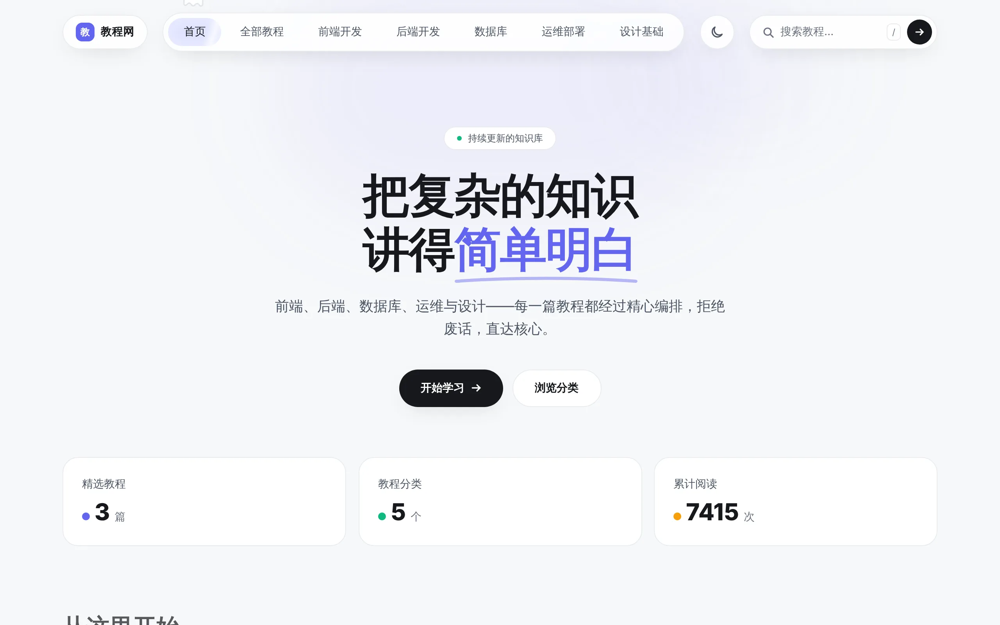
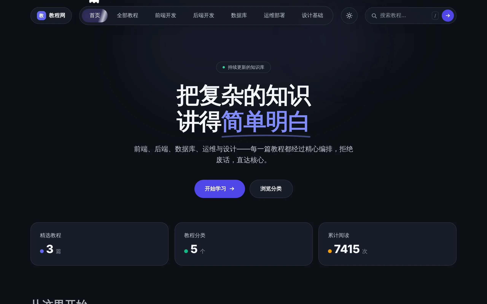
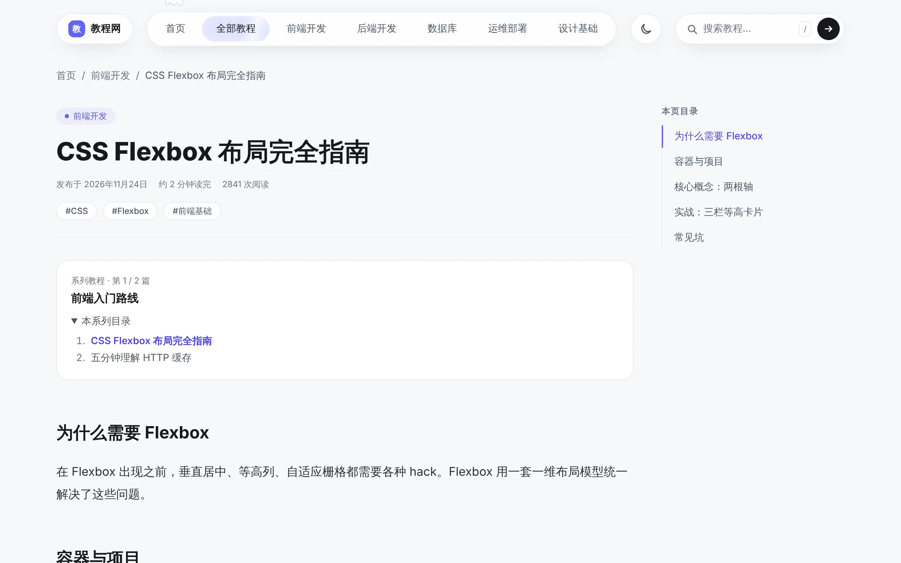
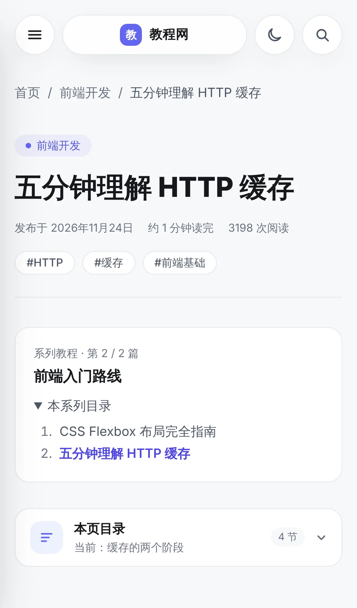
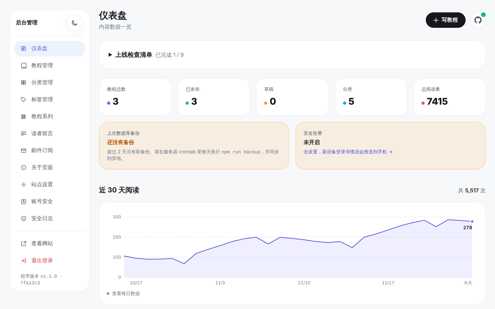
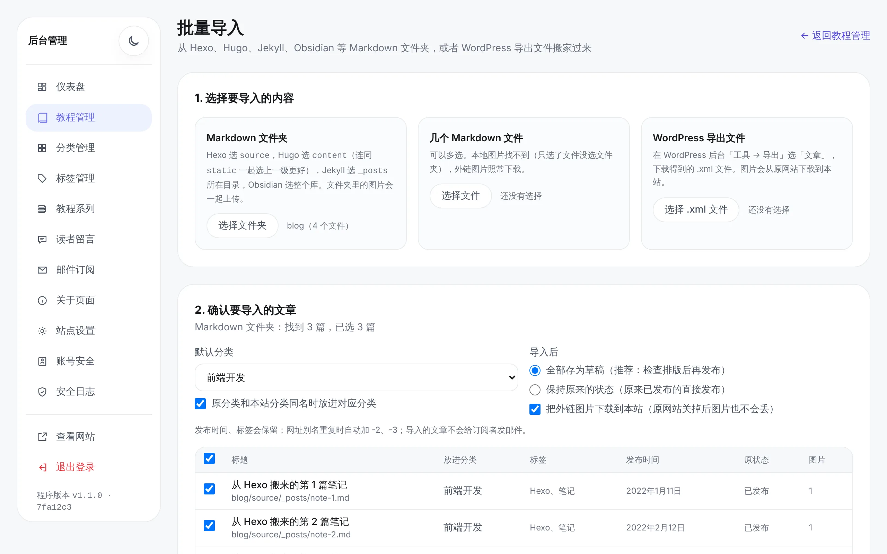

# チュートリアルサイト

[简体中文](README.md) | [English](README.en.md) | [Русский](README.ru.md) | **日本語**

画像付きチュートリアルのためのオープンソースのウェブサイトです。読者向けの公開ページと、執筆・管理用の管理画面がそろっています。サーバー 1 台で動きます（SQLite を使うので別途データベースは不要）。Next.js 16、React 19、Tailwind CSS v4、Prisma 7 製。画面は簡体字中国語・英語・ロシア語・日本語に対応しています。

> **免責事項**：本サイトのチュートリアルは個人の合法的な学習・研究のみを目的としており、違法行為や権利侵害に使用することを禁じます。内容を利用したことによる結果はすべて利用者の責任となります。内容の正確性は保証せず、予告なく変更することがあります。違反を発見した場合は調査に協力する権利を留保します。本サイトにアクセスした時点で本声明に同意したものとみなします。

## スクリーンショット

スクリーンショットは中国語の画面です。サイトの言語は管理画面で切り替えられます。

| ホーム（ライト） | ホーム（ダーク） |
| --- | --- |
|  |  |

| 記事（シリーズ目次 + ページ目次） | スマートフォン |
| --- | --- |
|  |  |

| ダッシュボード | 一括インポート |
| --- | --- |
|  |  |

## 機能

- **読む**：OS 設定に合わせたライト / ダークテーマ、目次、コードのハイライトとワンクリックコピー、画像の拡大表示、読書の進捗、前後の記事と関連記事、シリーズを「チュートリアルブック」として表示（章立て、読了チェック、続きから読む）、タグ、全文検索、RSS、印刷用レイアウト。低スペック端末ではアニメーションを自動でオフ
- **書く**：リッチテキストエディタ（画像のドラッグ＆ペースト、表、コードブロック、注意書き）、下書きの自動保存、版の履歴、プレビュー、予約公開、カバー画像、Markdown のインポート / エクスポート、Hexo / Hugo / Jekyll / Obsidian / WordPress からの一括移行（日付と画像を引き継ぎ、旧 URL のリダイレクト規則を生成）、メディアライブラリ
- **運営**：閲覧数の推移、人気記事、読了率、参照元サイト、読者の検索語、「役に立ちましたか？」の評価と読者からのメッセージ、新着記事のメール配信、任意で外部コメント（Waline / Twikoo / Artalk / Giscus）、投げ銭用 QR コードとスポンサー枠
- **カスタマイズ**：サイト名、ロゴ、ファビコン、テーマカラー、共有画像、ホームの文言、ナビゲーションのリンク、フッター、サイトの言語をすべて管理画面で変更でき、コードの修正は不要。複数人での運営（オーナー / 編集者 / 著者）
- **SEO**：サイトマップ、canonical、構造化データ、共有画像の自動生成、各検索エンジンのサイト確認
- **セキュリティ**：二段階認証と復旧コード、パスキー、失効できるセッション、ログイン試行の制限、本文 HTML の許可リスト方式のサニタイズ、厳格な CSP、セキュリティログと通知（DingTalk / Feishu / WeCom / Telegram / Webhook）、暗号化バックアップ、任意で Cloudflare のボット対策と AI 学習用クローラーの拒否

## Docker でのデプロイ

おすすめの方法です。Docker と Docker Compose が必要で、サーバーに Node を入れたりビルドしたりする必要はありません。イメージ `ghcr.io/vow132/tutorial-site` は amd64 と arm64 に対応しています。

```bash
git clone https://github.com/vow132/tutorial-site.git && cd tutorial-site
cp .env.example .env
# .env を編集：SITE_URL を公開 URL に、AUTH_SECRET を openssl rand -base64 48 の出力に変更
docker compose up -d
docker compose logs -f app     # Ready と表示されたら起動完了。ログにセットアップ URL とセットアップコードが出ます
```

必要なのは `docker-compose.yml` と `.env.example` の 2 ファイルだけで、リポジトリをクローンしなくても構いません。

- データはすべて `./docker-data/`（データベース、アップロード画像、バックアップ）にあり、イメージの更新やコンテナの再作成でも消えません。
- ポートは `127.0.0.1:3000` にのみバインドされます。前段に HTTPS 付きの Nginx / Caddy を置き（「セキュリティ対策」参照）、`.env` で `TRUST_PROXY=true` を設定してください。サンプルの Nginx 設定を使う場合は `/uploads/` の `alias` を `…/docker-data/uploads/` に変更します。
- `.env` を変更したら `docker compose up -d` で反映します。バージョンを固定するには `TUTORIAL_IMAGE=ghcr.io/vow132/tutorial-site:<バージョン>` を設定します。
- 運用コマンドはコンテナ内で `node` ユーザーとして実行します：`docker compose exec -u node app npm run backup`（root で実行するとデータベースファイルの所有者が root になり、サイトが書き込めなくなります）。
- 定期バックアップ：ホストの crontab に `17 3 * * * cd /path/to/tutorial-site && docker compose exec -T -u node app npm run backup` を追加し、`docker-data` を別の場所に同期します。

更新：`docker compose pull && docker compose up -d`

コードを変更した場合や ghcr.io に接続できない場合は自分でビルドします：`docker compose -f docker-compose.yml -f docker-compose.build.yml up -d --build`。ビルドは既定で npmmirror を使うので、遅い場合は `.env` に `NPM_REGISTRY=https://registry.npmjs.org/` を設定してください。フォークしたら自分のリポジトリで Actions を有効にすると、master への push のたびに `ghcr.io/<ユーザー名>/tutorial-site` がビルドされます。

## PM2 でのデプロイ

Node.js 22.12 以上（24 LTS 推奨）、npm、PM2 が必要です。

```bash
git clone https://github.com/vow132/tutorial-site.git && cd tutorial-site
cp .env.example .env.production   # ファイル内の説明に従って記入
bash deploy.sh                    # インストール → マイグレーション → 初期データ → ビルド → PM2 で起動
```

以後 `bash deploy.sh` を再実行しても、本番データベースのマイグレーション中の数秒を除いてサイトは動き続けます。

### Node.js のアップグレード

`node -v` が 22.12 未満の場合（nvm の例）：

```bash
nvm install 24 && nvm alias default 24
npm install -g pm2                          # nvm ではグローバルパッケージが Node のバージョンごとに別
pm2 info 教程网 | grep "exec cwd"          # 実行中のディレクトリを探して cd する
npm rebuild better-sqlite3                  # ネイティブモジュールなので Node のメジャー更新後は再ビルドが必要
pm2 update                                  # PM2 が新しい Node に切り替えてサイトを復元
```

### ワンクリック更新

PM2 でデプロイしたサイトは管理画面から更新できます。新しいバージョンが出るとダッシュボード右上の丸が黄色になるので、クリックしてパスワードを再入力します。更新は別プロセスで行われ（ダウンロード → インストール → データベースのコピーでマイグレーションとビルド → バックアップ → 切り替え → ヘルスチェック、失敗時は自動ロールバック）、停止するのは切り替え時の数秒だけで、初期データは投入されません。条件は Linux、PM2 のプロセスが 1 つ（既定名は `教程网`、`SITE_PM2_APP_NAME` で変更可）、`origin` が本リポジトリの Git デプロイ、サーバーから GitHub と npm にアクセスできることです。`SITE_AUTO_UPDATE="false"` で無効にできます。

初回のワンクリック更新後、PM2 は `.updates/active.config.cjs` からサイトを起動します。手動で再起動するときは `pm2 startOrReload .updates/active.config.cjs --update-env` を使ってください。フォークしてコードを変更した場合は、[カスタマイズガイド](docs/CUSTOMIZE.en.md)（英語）に従って手動で更新を取り込みます。

## 初回セットアップ

デプロイ後に `https://あなたのドメイン/admin` を開くとセットアップ画面になります。セットアップコード、サイト名、オーナーアカウントを入力し、サイトの言語を選びます。サンプルのチュートリアルを残して見た目を確認することも、空の状態から始めることもできます。

セットアップコードは、他人に先にオーナーアカウントを登録されないためのものです。サーバーの起動ログにだけ表示されます（`Setup code` で検索）：`docker compose logs app` または `pm2 logs 教程网`。見つからない場合は `npm run setup:code` を実行してください（Docker：`docker compose exec -u node app npm run setup:code`）。

初回起動前に環境変数で `ADMIN_USERNAME` と `ADMIN_PASSWORD` を設定すれば、セットアップ画面を省略できます。

その後、ダッシュボード上部の「公開前チェックリスト」に沿って、サイト名とブランドの変更、サンプルデータの削除、二段階認証の有効化、バックアップの設定を行います。

## 環境変数

説明付きの完全なテンプレートは [`.env.example`](.env.example) にあります（Docker は `.env`、PM2 は `.env.production`）。

| 変数 | 説明 |
| --- | --- |
| `SITE_URL` | **必須**。公開 URL（例：`https://example.com`） |
| `AUTH_SECRET` | **必須**。長いランダム文字列（`openssl rand -base64 48`）。未設定やサンプルのままだと管理画面にログインできません |
| `TRUST_PROXY` | Nginx / Caddy の背後では `true` にすると訪問者の実 IP を取得できます。Cloudflare の背後の場合は「Cloudflare」参照 |
| `ADMIN_USERNAME` / `ADMIN_PASSWORD` | 任意。初回起動時にオーナーアカウントを作成 |
| `DATA_ENCRYPTION_KEY` | 任意。データベース内の機密項目の暗号鍵。未設定時は `AUTH_SECRET` から導出 |
| `BACKUP_PASSPHRASE` | 任意。バックアップの暗号化パスフレーズ（12 文字以上）。必ず別の場所にも保管 |
| `ALERT_TIMEZONE` | 任意。通知メッセージのタイムゾーン（既定 `Asia/Shanghai`） |
| `DATABASE_URL` | PM2 デプロイでのデータベースの場所（既定 `file:./prisma/dev.db`） |

## 日常の運用

Docker の場合はコマンドの前に `docker compose exec -u node app` を付けます。

| コマンド | 内容 |
| --- | --- |
| `npm run backup` | データベースを `backups/` にオンラインバックアップ（14 世代保持。`BACKUP_PASSPHRASE` 設定時は暗号化）。`.db` を直接コピーしないでください。WAL モードでは最新データがまだ `-wal` にあることがあります |
| `npm run backup:restore -- <ファイル>` | バックアップを独立した `restored-….db` に展開して整合性を確認します。本番データベースには触れないので、表示される手順に従って差し替えます |
| `npm run admin:reset` | パスワードを忘れたとき：オーナーのパスワードをリセットし、二段階認証をオフ、パスキーを削除、全端末からログアウト、ボット対策をオフにします。`-- --username admin --password '新しいパスワード'` で指定も可 |
| `npm run uploads:clean` | どこからも参照されていないアップロード画像を一覧表示。`-- --apply` でアップロードフォルダ内の `.trash/` に移動（管理画面のメディアライブラリでも可） |
| `npm run setup:code` | 初回セットアップのコードを再表示 |
| `npm run images:variants` | 古い画像のレスポンシブ用サイズを生成 |

`/api/health` はサービスとデータベースの状態を返します（正常 200、異常 503）。Uptime Kuma などの死活監視に使えます。

## セキュリティ対策（公開前に必須）

1. **HTTPS のリバースプロキシを使い、3000 番ポートを直接公開しない。** [`deploy/nginx.conf.example`](deploy/nginx.conf.example) を参照してください（HTTP → HTTPS のリダイレクト、ログインと検索の回数制限、公開ページの 1 分キャッシュ、更新中は 502 ではなくキャッシュを返す）。ファイアウォールでは 80/443 だけを開け、`TRUST_PROXY="true"` と `SITE_URL="https://あなたのドメイン"` を設定します。
2. **定期的に別の場所へバックアップ。** crontab で毎日 `npm run backup` を実行し、バックアップとアップロードフォルダを別のマシンやオブジェクトストレージに同期します（rclone など）。`BACKUP_PASSPHRASE` での暗号化を推奨します。
3. **アカウント。** 強いパスワードを使い、二段階認証（使い捨ての復旧コードが 10 個発行されます）かパスキー（HTTPS とドメイン名が必要）を有効にします。ワンクリック更新は `master` ブランチをデプロイするので、GitHub アカウントにも二段階認証を設定し、`master` を保護してください。
4. **セキュリティ通知。** 管理画面の「アカウントのセキュリティ → セキュリティ通知」で DingTalk、Feishu、WeCom、Telegram、Webhook のいずれかを選びます。新しい端末からのログイン、ログインのロック、パスワード / 二段階認証 / パスキーの変更、ワンクリック更新の結果、バックアップの失敗や 2 日以上の未実行を通知します。
5. **脆弱性の報告窓口。** 「サイト設定 → セキュリティ窓口」にメールアドレスか URL を入れると `/.well-known/security.txt` を提供します。
6. **依存関係。** Dependabot が毎週更新を提案するので、早めに取り込んでください。

管理画面の「セキュリティログ」には、ログイン、パスワード変更、公開、アップロード、デプロイなどが 1 年間記録されます。

## オプション機能

### 複数人での運営

オーナーが「アカウント管理」で各自のアカウントを作成します（初期パスワードはランダムで、表示は 1 回だけ）。

| 役割 | できること |
| --- | --- |
| オーナー | すべて（サイト設定、アカウント管理、メール配信、セキュリティログ、ワンクリック更新を含む） |
| 編集者 | すべてのチュートリアル、カテゴリ、タグ、シリーズ、サイト紹介ページ、読者からのメッセージ、一括インポート、メディアライブラリ |
| 著者 | 自分のチュートリアルの執筆・編集・公開・削除のみ |

記事ページには各自が「アカウントのセキュリティ」で設定した署名が表示されます。ログイン用のユーザー名が公開ページに出ることはありません。

### 多言語

画面は簡体字中国語・英語・ロシア語・日本語に対応しています。

- **サイトの言語**（「サイト設定 → サイトの言語」）：公開ページの画面表示、RSS、メール、通知メッセージがこの言語になります。切り替えると、既定値のままのサイト名・ホームの文言・フッターは新しい言語の既定値に変わり、変更済みのものはそのまま残ります。
- **読者の言語**：訪問者はテーマボタンの横にある地球ボタンで、読める言語に切り替えられます。本人にだけ反映され、選んでいない訪問者と検索エンジンにはサイトの言語で表示されます。チュートリアル本文は翻訳されません。
- **管理画面の言語**：各管理者がサイドバー下部（またはログイン画面）で自分用に選びます。ブラウザに保存され、他の人や公開ページには影響しません。
- **サーバーでのコマンド**（バックアップ、復元、管理者のリセットなど）：中国語サイトでは中国語、それ以外の言語のサイトでは英語で出力します。デプロイスクリプトと Docker の起動ログは両方の言語で書きます。

チュートリアル本文の言語は自由です。サンプルのチュートリアルは中国語で、ダッシュボードからワンクリックで削除できます。

### メール配信

SMTP サービスが必要です。まずメール事業者で送信ドメインを認証して SPF / DKIM レコードを追加し、管理画面の「メール配信」で SMTP 情報を入力、テストメールを送ってから有効にします。読者はメールで購読を確認し、新しいチュートリアル（予約公開を含む）ごとに 1 回だけ通知が届きます。ワンクリックで配信停止できます。

### コメント

本サイト自体はコメントを保存しません。「サイト設定 → コメント」で Waline、Twikoo、Artalk（自前のサーバー）、Giscus（GitHub Discussions）のいずれかを選ぶと、コメントはあなたのサービスに保存されます。コメント欄は記事の末尾にあり、読者が近くまでスクロールしたときに読み込まれます。

### 画像の高速配信

「サイト設定 → 画像の高速配信」に、本サイトをオリジンとする CDN またはオブジェクトストレージのドメインを入力し、「テスト」が通ったら保存します。画像は本サイトに残るので移動は不要で、空欄にすれば元に戻ります。

### Cloudflare

**ボット対策（Turnstile）**：Cloudflare のダッシュボードで Turnstile → Add widget（モードは Managed）を作成し、Site Key と Secret Key を「サイト設定 → ボット対策」に入力して、一度検証を通してから保存します。以後、パスワードでのログイン、メール配信の登録、読者からのメッセージには検証が必要になります（パスキーでのログインは不要）。Cloudflare の CDN を使っていなくても利用できます。有効にした後に誰もログインできなくなったら、`npm run admin:reset` でこれもオフになります。

**サイトを Cloudflare の背後（オレンジの雲）に置く場合は、先に実 IP を設定してください。** そうしないとすべての訪問者が少数の IP に見え、ログインの回数制限が全員に影響します。次のどちらかを選びます。

- 推奨：[`deploy/nginx.conf.example`](deploy/nginx.conf.example) の「Cloudflare の背後」のブロック（`real_ip_header CF-Connecting-IP` と [Cloudflare の IP レンジ](https://www.cloudflare.com/ips/)）を有効にし、`TRUST_PROXY="true"` のままにする
- Nginx を使わず Cloudflare から Next に直接つなぐ場合：`TRUST_PROXY="cloudflare"`

どちらもファイアウォールで 80/443 を Cloudflare の IP レンジにだけ開ける必要があります。SSL/TLS モードは Full (strict) にします。公開前チェックリストで実 IP が取れているか確認できます。

**スクレイピング**：「サイト設定 → スクレイピング対策」で、GPTBot、ClaudeBot、CCBot などの AI 学習用クローラーを `robots.txt` で拒否したり（検索エンジンは引き続きインデックスします）、長い本文をコピーしたときに出典を付けたりできます。大量の取得を本当に防ぐには、Cloudflare で Bot Fight Mode と「Block AI bots」を有効にし、レート制限ルール（例：`/tutorials/` で始まるパスに同一 IP から 10 秒で 10 回超 → Managed Challenge）と Hotlink Protection を設定してください。Cloudflare を使わない場合は、サンプルの Nginx 設定に記事ページを IP ごとに制限する例があります。

### デモサイト

管理画面を公開して見せたい場合は、別のコピーをデプロイし、`.env` に公開用のデモアカウントと `DEMO_MODE="true"` を追加します。

```dotenv
ADMIN_USERNAME="demo"
ADMIN_PASSWORD="デモ専用のパスワード"
DEMO_MODE="true"
```

デモモードではログインフォームが入力済みになり、管理画面はすべて閲覧できますが、保存・アップロード・削除・パスワード変更・ワンクリック更新は反映されません。読者からのメッセージや検索語は保存されず、メール配信はオフ、他の訪問者の IP は伏せられます。デモの内容を変えるときは `DEMO_MODE` をコメントアウトして再起動し、変更後に戻します。**本番サイトでは有効にしないでください**。管理画面のパスワードを公開するのと同じです。

## ローカル開発

```bash
npm ci
npx prisma generate
npx prisma migrate deploy
npx prisma db seed
npm run dev        # http://localhost:3000、管理画面は /admin、アカウントは admin / admin123456
```

テスト：`npm test`（単体テスト）、`npm run build && npm run test:e2e`（Playwright による E2E テスト。`e2e-` で始まるデータを作成・削除するので、開発用データベースでのみ実行してください）。

## ドキュメント

- [カスタマイズガイド](docs/CUSTOMIZE.en.md)（英語）：管理画面で変えられること、コードを変えるときのファイル、フォークを最新に保つ方法
- [CHANGELOG.md](CHANGELOG.md)（中国語）：更新履歴（管理画面サイドバーの下部に実行中のバージョンを表示）
- [CONTRIBUTING.en.md](CONTRIBUTING.en.md)（英語）：開発への参加
- [SECURITY.en.md](SECURITY.en.md)（英語）：セキュリティ問題の非公開での報告
