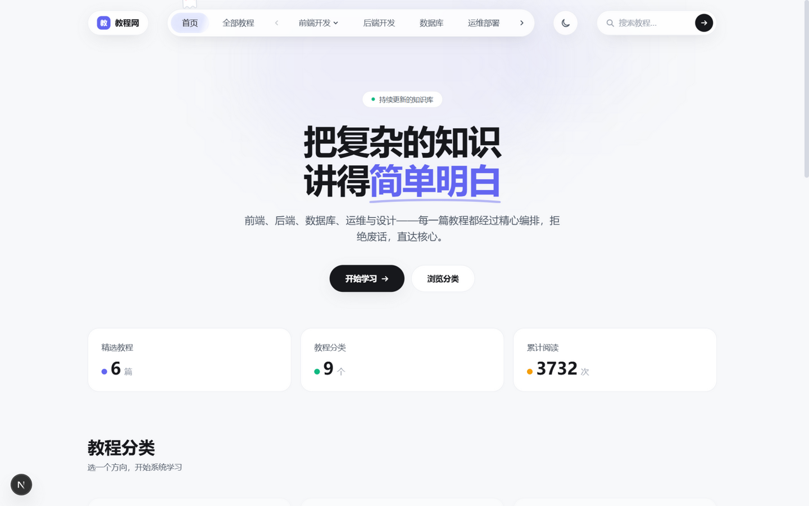
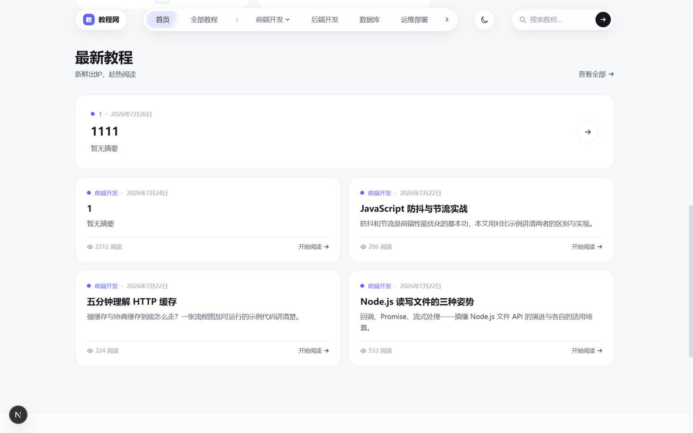
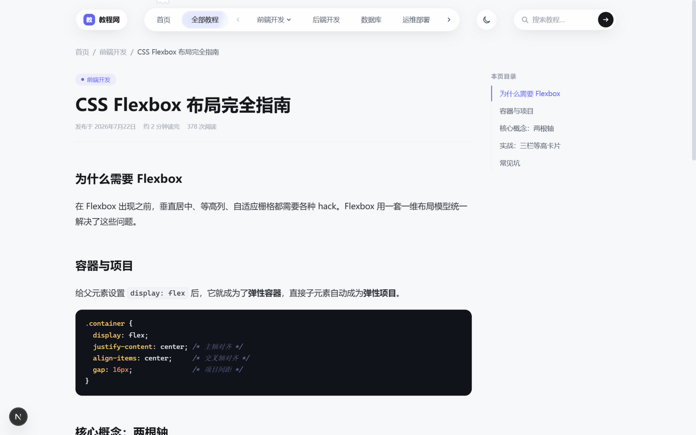
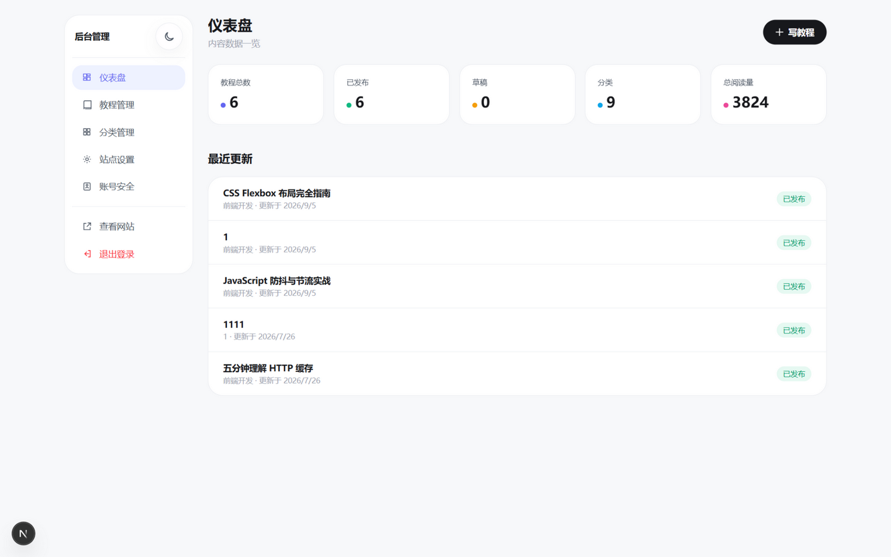

# 教程网

基于 Next.js 16.4（App Router + webpack）、React 19、Tailwind CSS v4、Prisma 7 + SQLite 的图文教程平台。

## 免责声明
本站教程仅供个人合法学习研究，严禁用于违法、侵权等行为。用户使用内容产生的一切实操后果自行承担，与本站无关。
本站不保证内容绝对无误，有权随时调整内容；
如发现违规，我方保留配合调查的权利。访问本站即同意本声明。
## 项目预览

| 首页（亮色） | 首页（暗色） |
| --- | --- |
|  |  |

| 最新教程 | 文章阅读 |
| --- | --- |
|  |  |

| 管理后台 |
| --- |
|  |

## 功能特性

- **前台**：悬浮胶囊导航（分类翻页、aura/流光动效）、亮暗双主题（跟随手动切换持久化）、鼠标跟随聚光灯卡片与轻微 3D 倾斜、滚动触发的分区渐显、小幽灵吉祥物
- **文章**：服务端 TOC 提取与高亮（highlight.js）、移动端可折叠目录、图片自动注入宽高防布局抖动、上下篇导航；上传图片自动缩放到 1600px 宽并转 WebP、去除 EXIF 定位信息
- **后台**：Tiptap 3 富文本编辑器（拖拽/粘贴上传图片）、分类树管理（最多三级、防循环依赖）、站点设置可视化编辑、账号安全
- **SEO 与健壮性**：动态 sitemap / robots、OpenGraph 元信息、真实 404 状态码、越界分页自动收敛、空/加载/错误状态齐全
- **安全**：可吊销的服务端会话 + 两步验证（TOTP）、受信任设备感知的登录限流、正文 HTML 白名单过滤、按文件头校验上传（不接受 SVG）、CSP/HSTS 等安全响应头、后台安全日志、Server Actions 与后台页面逐一鉴权，详见「安全加固」

## 本地运行

```bash
npm ci
npx prisma generate
npx prisma migrate deploy
npx prisma db seed
npm run dev
```

打开 `http://localhost:3000`，后台为 `/admin`。

## 生产部署

服务器要求：Node.js >= 20.9、npm、PM2。推荐使用项目根目录的脚本：

```bash
bash deploy.sh
```

脚本会按“安装依赖 → Prisma generate → migrate → seed → build → PM2 平滑重载”的顺序执行。迁移和种子数据必须在 `npm run build` 之前完成，否则静态主页可能把空数据库内容生成到 `.next` 中。

### 环境变量

在服务器设置 `.env.production`：

```dotenv
DATABASE_URL="file:./prisma/dev.db"
ADMIN_USERNAME="admin"
# 首次部署时的管理员密码；不设置时生产环境会随机生成并在部署输出中显示一次
ADMIN_PASSWORD="请修改为强密码"
# 会话签名密钥：必须替换为随机长字符串（openssl rand -base64 48），
# 使用已知占位值时生产环境会拒绝启动
AUTH_SECRET="请替换为随机长字符串"
# 登录 Cookie 的 Secure 标记：不设置时自动判断（经 HTTPS 访问即开启）；
# 也可显式设为 true / false 覆盖
# SESSION_COOKIE_SECURE="true"
# 只有 Next 端口不对公网开放、所有请求都经过 Nginx/Caddy 时才设为 true，
# 这样限流、安全日志和阅读量去重才会采用代理传来的真实访客 IP
# TRUST_PROXY="true"
# 站点对外地址（用于 sitemap / OpenGraph 的绝对链接），如：
# SITE_URL="https://example.com"
SITE_URL="http://localhost:3000"
```

`DATABASE_URL` 的相对路径以项目根目录为基准。PM2 配置已经固定 `cwd`，运行时和 Prisma CLI 会使用同一个数据库文件。

### 后台 GitHub 入口与一键更新

仪表盘右上角「写教程」旁的 GitHub 图标会打开 `vow132/tutorial-site`。右上角圆点每 5 分钟检测一次仓库的 `master` 分支：绿色表示无需更新，黄色表示有新版本，点击黄色圆点并**再次输入管理员密码**后提交更新任务（部署会在服务器上执行新代码，即使会话有效也要二次确认，并记入安全日志）；灰色表示正在检测或无法自动更新，红色表示失败，点击可查看原因。更新中的黄色圆点会显示当前步骤，成功后页面自动刷新。

一键更新适用于 **Linux + 单个 PM2 fork 模式进程** 的 Git 部署，默认进程名称为 `教程网`，需要 Git、npm、目录写入权限以及 GitHub / npm 网络访问。本地开发、Windows 或无 Git 的部署只检测版本。服务器存在未提交修改、运行版本与 Git 目录不一致、仓库历史分叉时，会停止自动更新。

可选服务器环境变量（`.env.production`）：

```dotenv
SITE_AUTO_UPDATE="true"        # 设为 false 可关闭一键更新
SITE_UPDATE_BRANCH="master"   # 要检测和部署的仓库分支
SITE_PM2_APP_NAME="教程网"      # 已运行的单个 PM2 进程名称
# GITHUB_TOKEN="..."          # 可选，只在服务端使用，提升 GitHub API 检测额度
# SITE_UPDATE_REQUIRE_SIGNED="true"  # 可选，只部署通过 git verify-commit 校验的签名提交
```

开启 `SITE_UPDATE_REQUIRE_SIGNED` 前需在服务器上配置可信的 GPG 公钥或 SSH `gpg.ssh.allowedSignersFile`，并确保仓库提交都已签名。

GitHub API 令牌仅用于版本检测；拉取源码使用服务器已配置的 Git 凭据。当前公共仓库无需凭据。生产构建会记录 Git 提交，检测时比较正在运行的构建版本，不能仅靠 `git pull` 改变版本圆点。

更新任务在独立进程中执行：下载固定提交 → 安装依赖 → 对数据库副本迁移并构建 → 暂停旧服务 → 备份最新数据库 → 对真实数据库迁移 → 切换 PM2 → 检查版本和服务健康。构建期间原网站继续运行，切换期间会短暂中断；切换失败会尝试恢复数据库和原版本，并验证恢复后的服务。更新不会运行 seed，已有教程、账号和设置保留；上传目录始终共享原项目的 `public/uploads`。

更新状态和日志在 `.updates/status.json`、`.updates/worker.log`。发布目录、数据库备份与旧 PM2 配置也保存在 `.updates/`，供手动恢复；这些文件含站点数据或环境配置，请限制权限。每次更新成功后自动清理：除正在运行的版本和回滚目标外只保留最近 2 个发布目录，数据库备份与旧 PM2 配置各保留最近 5 份。

**首次自动更新后，PM2 使用 `.updates/active.config.cjs` 启动新版本**，并通过 `pm2 save` 持久化。以后手动启动请使用：

```bash
pm2 startOrReload .updates/active.config.cjs --update-env
```

原始 Git 工作目录不被自动更新覆盖；再次执行原目录的 `deploy.sh` 或 `ecosystem.config.cjs` 会部署原目录代码。`SITE_UPDATE_ROOT` 必须保持为原项目的绝对路径（初始 PM2 配置和更新脚本自动设置），数据库使用同一共享文件。

运行全部单元测试（含更新模块与安全模块，不执行真实部署）：

```bash
npm test
```

## 管理员账号修改

登录后台后进入侧栏 **账号安全**（`/admin/account`）：

- 修改用户名或密码都需要输入当前密码确认；
- 新密码至少 10 位，且不能是常见弱口令或包含用户名；仍在使用默认/弱密码登录时会被直接带到这里；
- 保存后当前浏览器保持登录，**其他设备上的登录全部失效**；
- **两步验证**：用验证器 App 扫码并输入 6 位数字即可开启，之后登录需要密码 + 验证码；
- **登录设备**：列出所有未过期的会话，可一键「退出其他设备」或「退出所有设备」。退出登录会删除服务端会话，复制走的 Cookie 立即失效。

登录限流只统计失败次数：

- 曾在本浏览器登录成功过的「受信任设备」单独计数（15 分钟 5 次），攻击者刷错密码锁不住管理员常用的浏览器；
- 陌生设备按用户名（15 分钟 10 次）、IP（配置 `TRUST_PROXY` 后，15 分钟 20 次）和全站总量（5 分钟 100 次）计数。

忘记密码或丢失两步验证手机时，在服务器项目目录执行：

```bash
npm run admin:reset                       # 随机生成新密码并打印
npm run admin:reset -- --password '新的强密码' --username admin
```

该命令会重置密码、关闭两步验证并退出所有设备。后台 **安全日志**（`/admin/audit`）记录登录、改密、发布、上传、部署等操作，保留一年。

## 安全加固（上线必做）

**1. HTTPS 反向代理，不要直接暴露 3000 端口。** Nginx 示例（`http {}` 中先定义限流区）：

```nginx
limit_req_zone $binary_remote_addr zone=tutorial_login:10m  rate=10r/m;
limit_req_zone $binary_remote_addr zone=tutorial_search:10m rate=30r/m;

server {
    listen 80;
    server_name example.com;
    return 301 https://$host$request_uri;
}

server {
    listen 443 ssl;
    http2 on;
    server_name example.com;
    ssl_certificate     /etc/letsencrypt/live/example.com/fullchain.pem;
    ssl_certificate_key /etc/letsencrypt/live/example.com/privkey.pem;
    client_max_body_size 6m;

    proxy_set_header Host              $host;
    proxy_set_header X-Real-IP         $remote_addr;
    proxy_set_header X-Forwarded-For   $proxy_add_x_forwarded_for;
    proxy_set_header X-Forwarded-Proto $scheme;

    # 上传图片由 Nginx 直接读磁盘，减轻 Node 压力（不配置也能工作，由 Next 提供）
    location /uploads/ {
        alias /path/to/tutorial-site/public/uploads/;
        add_header Cache-Control "public, max-age=31536000, immutable" always;
        add_header Content-Security-Policy "default-src 'none'; img-src 'self'; style-src 'unsafe-inline'; sandbox" always;
        add_header X-Content-Type-Options nosniff always;
    }

    location = /admin/login { limit_req zone=tutorial_login  burst=10 nodelay; proxy_pass http://127.0.0.1:3000; }
    location = /search      { limit_req zone=tutorial_search burst=20 nodelay; proxy_pass http://127.0.0.1:3000; }
    location /              { proxy_pass http://127.0.0.1:3000; }
}
```

然后：防火墙只放行 80/443（如 `ufw deny 3000`），在 `.env.production` 中设置 `TRUST_PROXY="true"` 与 `SITE_URL="https://你的域名"`。经 HTTPS 访问时站点会自动下发 HSTS、给 Cookie 加 Secure 标记。

**2. 定期异地备份。** `npm run backup` 会在线备份 SQLite 到 `backups/`（gzip 压缩，默认保留 14 份，`BACKUP_DIR` / `BACKUP_KEEP` 可调）。建议加入 crontab，并把备份和上传目录同步到另一台机器或对象存储：

```cron
17 3 * * * cd /path/to/tutorial-site && npm run backup >> backups/backup.log 2>&1
47 3 * * * rclone sync /path/to/tutorial-site/backups remote:tutorial-backups && rclone sync /path/to/tutorial-site/public/uploads remote:tutorial-uploads
```

**3. 账号。** 首次登录后立即修改密码并开启两步验证；GitHub 账号同样开启两步验证并为 `master` 设置分支保护，因为一键更新会部署该分支的最新提交。不需要在线更新的部署可设置 `SITE_AUTO_UPDATE="false"`。

**4. 依赖。** CI 会单独运行 `npm audit`，Dependabot 每周提交依赖更新 PR，请及时合并。
