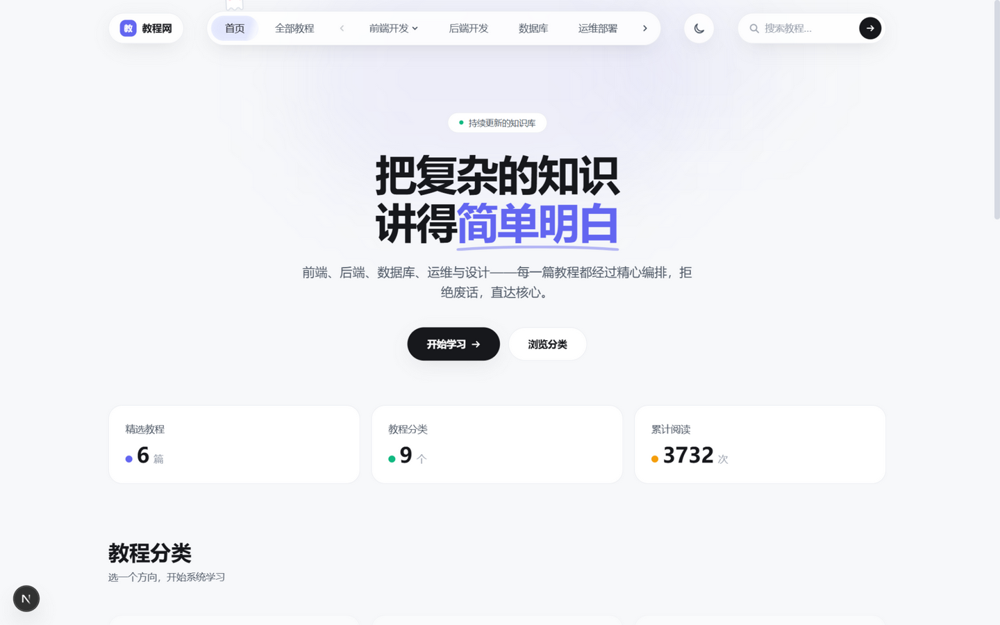
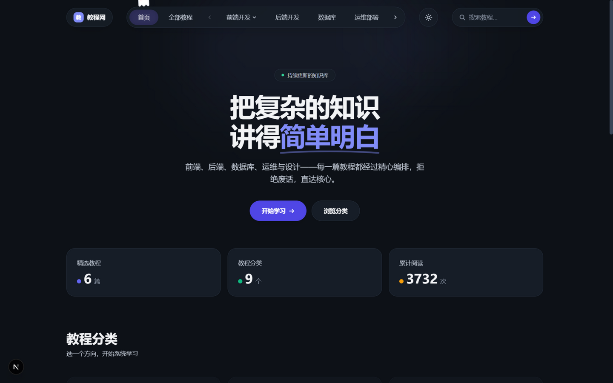
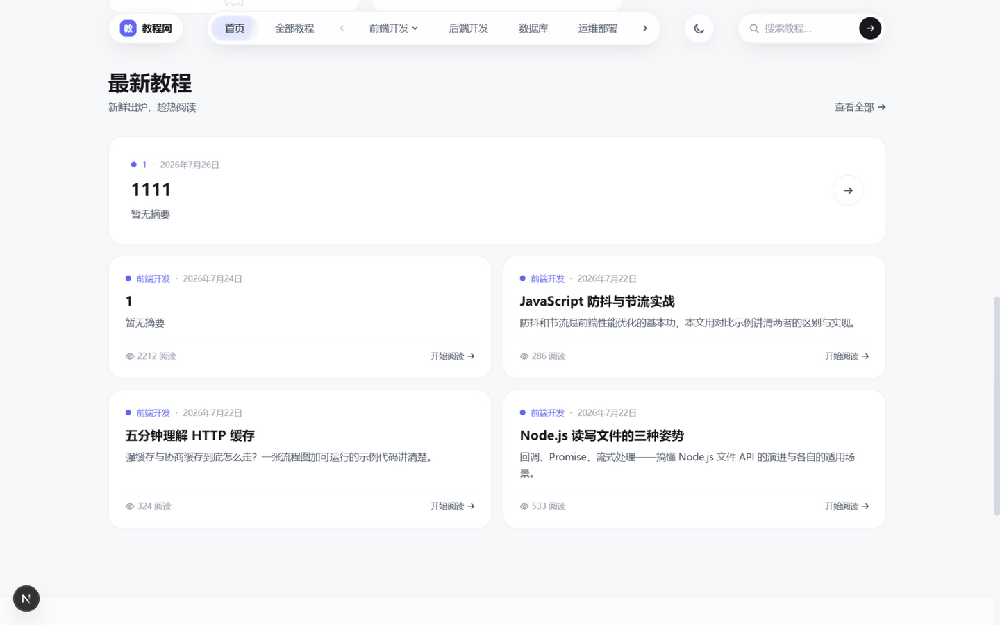
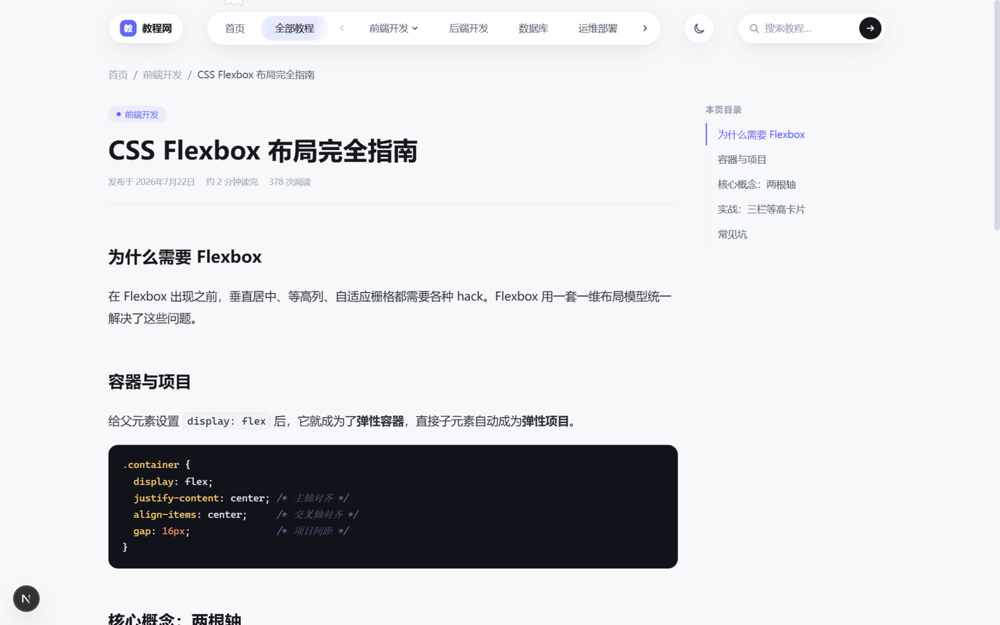
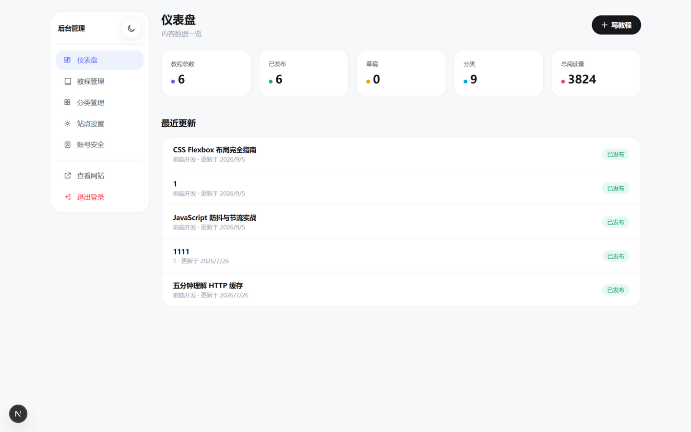

# 教程网

基于 Next.js 16.4（App Router + webpack）、React 19、Tailwind CSS v4、Prisma 7 + SQLite 的图文教程平台。

## 免责声明
本站教程仅供个人合法学习研究，严禁用于违法、侵权等行为。用户使用内容产生的一切实操后果自行承担，与本站无关。
本站不保证内容绝对无误，有权随时调整内容；
如发现违规，我方保留配合调查的权利。访问本站即同意本声明。
## 项目预览

| 首页（亮色） | 首页（暗色） |
| --- | --- |
|  |  |

| 最新教程 | 文章阅读 |
| --- | --- |
|  |  |

| 管理后台 |
| --- |
|  |

## 功能特性

- **前台**：悬浮胶囊导航（分类翻页、aura/流光动效）、亮暗双主题（跟随手动切换持久化）、鼠标跟随聚光灯卡片与轻微 3D 倾斜、滚动触发的分区渐显、小幽灵吉祥物；低端设备（内存 < 4GB、CPU < 4 核）或开启省流量时自动进入精简模式，关掉毛玻璃、装饰光晕和循环动画
- **文章**：服务端 TOC 提取与高亮（highlight.js）、代码块语言标签与一键复制、标题旁 `#` 复制章节链接（锚点按标题文字生成，改动其他段落不会失效）、点击图片放大、打印/另存 PDF 专用排版、显示最后更新日期、移动端可折叠目录、图片自动注入宽高防布局抖动、上下篇导航与相关教程推荐、顶部阅读进度条与「回到顶部」、文末「这篇有帮助吗」反馈（点「没帮助」可以留一句话给站长）、复制链接 / 微信扫码分享；按 `/` 或 Ctrl/⌘+K 聚焦搜索，404 页提供搜索框和最新教程；上传图片自动缩放到 1600px 宽并转 WebP、去除 EXIF 定位信息，并生成 800/1200px 小图供手机按屏幕加载
- **后台**：Tiptap 3 富文本编辑器（拖拽/粘贴上传图片、表格、代码块选语言、提示/注意/警告提示框；边写边自动保存到本浏览器，误关页面或登录过期可恢复）、教程历史版本（每次保存留旧版，可预览和一键恢复）、草稿预览、定时发布、教程封面图（文章头图 + 分享卡片；列表卡片显示缩略图，没设封面时用正文第一张图）、教程标签（每篇最多 8 个，后台可改名/合并/删除）、教程系列（几篇按顺序组成一组，文章页显示「第 2 / 5 篇」目录和本系列上下篇，每个系列有自己的页面 `/series/…`）、仪表盘近 30 天阅读趋势与热门教程（含读完率和读者反馈好评率）、阅读来源（百度 / 微信 / 直接访问…）、读者搜了什么和「没搜到结果」的词（选题清单）、读者留言收件箱、Markdown 导入导出、教程列表按标题搜索和按状态/分类筛选、可编辑的「关于本站」页面、分类树管理（最多三级、防循环依赖）、站点设置可视化编辑、账号安全
- **SEO 与健壮性**：动态 sitemap / robots、canonical、逐页 OpenGraph/Twitter 分享卡片（没有封面的文章自动生成「标题 + 分类」分享图，字体随项目打包，生成时不访问外网）、标签页（`/tags`，相关教程优先按共同标签推荐；只有一篇教程的标签页不收录）、系列页（`/series`，带 CreativeWorkSeries 结构化数据，只有一篇的系列不收录）、搜索结果显示关键词所在的那段正文、关于页（`/about`）、Article/面包屑/WebSite 结构化数据、后台填写 Google/Bing/百度/360/搜狗/神马/Yandex 站长验证码、真实 404 状态码、越界分页自动收敛、空/加载/错误状态齐全
- **安全**：可吊销的服务端会话 + 两步验证（TOTP，含一次性恢复码）+ 通行密钥、敏感字段与备份加密、`security.txt`、受信任设备感知的登录限流、正文 HTML 白名单过滤、按文件头校验上传（不接受 SVG）、CSP/HSTS 等安全响应头、后台安全日志、Server Actions 与后台页面逐一鉴权，详见「安全加固」

## 本地运行

```bash
npm ci
npx prisma generate
npx prisma migrate deploy
npx prisma db seed
npm run dev
```

打开 `http://localhost:3000`，后台为 `/admin`。

## 生产部署

服务器要求：Node.js >= 22.12（推荐 24 LTS；Node 20 已于 2026 年 4 月停止维护）、npm、PM2。推荐使用项目根目录的脚本：

```bash
bash deploy.sh
```

脚本会按“安装依赖 → Prisma generate → migrate → seed → build → PM2 平滑重载”的顺序执行。迁移和种子数据必须在 `npm run build` 之前完成，否则静态主页可能把空数据库内容生成到 `.next` 中。

### 升级 Node.js

先用 `node -v` 查看版本，低于 22.12 时按下面升级（以 nvm 为例，也可以用系统包管理器安装 Node 24）：

```bash
nvm install 24 && nvm alias default 24
npm install -g pm2            # nvm 下每个 Node 版本的全局包是分开的，需要重装 PM2
pm2 info 教程网 | grep "exec cwd"   # 找到正在运行的目录（用过一键更新时在 .updates/releases/ 下）
cd <上一步的 exec cwd>
npm rebuild better-sqlite3    # SQLite 驱动是原生模块，换 Node 大版本后必须重新编译
pm2 update                    # 让 PM2 守护进程改用新 Node 并恢复站点
pm2 info 教程网 | grep "node.js version"   # 确认已是 24.x，再打开网站检查
```

之后的一键更新会在新 Node 下重新安装依赖，不需要再手动处理。

### 环境变量

在服务器设置 `.env.production`：

```dotenv
DATABASE_URL="file:./prisma/dev.db"
ADMIN_USERNAME="admin"
# 首次部署时的管理员密码；不设置时生产环境会随机生成并在部署输出中显示一次
ADMIN_PASSWORD="请修改为强密码"
# 会话签名密钥：必须替换为随机长字符串（openssl rand -base64 48），
# 使用已知占位值时生产环境会拒绝启动
AUTH_SECRET="请替换为随机长字符串"
# 登录 Cookie 的 Secure 标记：不设置时自动判断（经 HTTPS 访问即开启）；
# 也可显式设为 true / false 覆盖
# SESSION_COOKIE_SECURE="true"
# 只有 Next 端口不对公网开放、所有请求都经过 Nginx/Caddy 时才设为 true，
# 这样限流、安全日志和阅读量去重才会采用代理传来的真实访客 IP
# TRUST_PROXY="true"
# 站点对外地址（canonical、sitemap、分享卡片、结构化数据的绝对链接），生产环境必须设置，
# 未设置或指向 localhost 时服务启动会打印警告，如：
# SITE_URL="https://example.com"
SITE_URL="http://localhost:3000"
# 安全告警消息里的时间按哪个时区显示（默认北京时间）
# ALERT_TIMEZONE="Asia/Shanghai"
# 数据库里敏感字段（两步验证密钥、告警推送地址/Token）的加密密钥。不设置时由 AUTH_SECRET 派生；
# 单独设置后更换 AUTH_SECRET（让所有登录失效）不会影响这些数据。设置后重启即自动重新加密。
# DATA_ENCRYPTION_KEY="另一个随机长字符串（openssl rand -base64 48）"
# 备份加密口令（至少 12 位）：设置后 npm run backup 输出加密的 .db.gz.enc。务必另外保管一份，丢了无法还原
# BACKUP_PASSPHRASE="一个只用于备份的长口令"
```

`DATABASE_URL` 的相对路径以项目根目录为基准。PM2 配置已经固定 `cwd`，运行时和 Prisma CLI 会使用同一个数据库文件。

### 后台 GitHub 入口与一键更新

仪表盘右上角「写教程」旁的 GitHub 图标会打开 `vow132/tutorial-site`。右上角圆点每 5 分钟检测一次仓库的 `master` 分支：绿色表示无需更新，黄色表示有新版本，点击黄色圆点并**再次输入管理员密码**后提交更新任务（部署会在服务器上执行新代码，即使会话有效也要二次确认，并记入安全日志）；灰色表示正在检测或无法自动更新，红色表示失败，点击可查看原因。更新中的黄色圆点会显示当前步骤，成功后页面自动刷新。

一键更新适用于 **Linux + 单个 PM2 fork 模式进程** 的 Git 部署，默认进程名称为 `教程网`，需要 Git、npm、目录写入权限以及 GitHub / npm 网络访问。本地开发、Windows 或无 Git 的部署只检测版本。服务器存在未提交修改、运行版本与 Git 目录不一致、仓库历史分叉时，会停止自动更新。

可选服务器环境变量（`.env.production`）：

```dotenv
SITE_AUTO_UPDATE="true"        # 设为 false 可关闭一键更新
SITE_UPDATE_BRANCH="master"   # 要检测和部署的仓库分支
SITE_PM2_APP_NAME="教程网"      # 已运行的单个 PM2 进程名称
# GITHUB_TOKEN="..."          # 可选，只在服务端使用，提升 GitHub API 检测额度
# SITE_UPDATE_REQUIRE_SIGNED="true"  # 可选，只部署通过 git verify-commit 校验的签名提交
```

开启 `SITE_UPDATE_REQUIRE_SIGNED` 前需在服务器上配置可信的 GPG 公钥或 SSH `gpg.ssh.allowedSignersFile`，并确保仓库提交都已签名。

GitHub API 令牌仅用于版本检测；拉取源码使用服务器已配置的 Git 凭据。当前公共仓库无需凭据。生产构建会记录 Git 提交，检测时比较正在运行的构建版本，不能仅靠 `git pull` 改变版本圆点。

更新任务在独立进程中执行：下载固定提交 → 安装依赖 → 对数据库副本迁移并构建 → 暂停旧服务 → 备份最新数据库 → 对真实数据库迁移 → 切换 PM2 → 检查版本和服务健康。构建期间原网站继续运行，切换期间会短暂中断；切换失败会尝试恢复数据库和原版本，并验证恢复后的服务。更新不会运行 seed，已有教程、账号和设置保留；上传目录始终共享原项目的 `public/uploads`。

更新状态和日志在 `.updates/status.json`、`.updates/worker.log`。发布目录、数据库备份与旧 PM2 配置也保存在 `.updates/`，供手动恢复；这些文件含站点数据或环境配置，请限制权限。每次更新成功后自动清理：除正在运行的版本和回滚目标外只保留最近 2 个发布目录，数据库备份与旧 PM2 配置各保留最近 5 份。

**首次自动更新后，PM2 使用 `.updates/active.config.cjs` 启动新版本**，并通过 `pm2 save` 持久化。以后手动启动请使用：

```bash
pm2 startOrReload .updates/active.config.cjs --update-env
```

原始 Git 工作目录不被自动更新覆盖；再次执行原目录的 `deploy.sh` 或 `ecosystem.config.cjs` 会部署原目录代码。`SITE_UPDATE_ROOT` 必须保持为原项目的绝对路径（初始 PM2 配置和更新脚本自动设置），数据库使用同一共享文件。

运行全部单元测试（含更新模块与安全模块，不执行真实部署）：

```bash
npm test
```

端到端测试（Playwright，在真实浏览器里走一遍前台页面、SEO 输出、后台发文/改 slug/删除与缓存失效、站点设置、安全响应头）。测试会新建并删除 `e2e-` 前缀的教程，**只对开发/测试数据库运行**；CI 会在 Node 24 上自动执行：

```bash
npx playwright install chromium   # 首次运行前安装浏览器
npm run build
E2E_ADMIN_PASSWORD='你的后台密码' npm run test:e2e   # 默认读取 ADMIN_USERNAME / ADMIN_PASSWORD，未设置时用 admin / admin123456
```

## 管理员账号修改

登录后台后进入侧栏 **账号安全**（`/admin/account`）：

- 修改用户名或密码都需要输入当前密码确认；
- 新密码至少 10 位，且不能是常见弱口令或包含用户名；仍在使用默认/弱密码登录时会被直接带到这里；
- 保存后当前浏览器保持登录，**其他设备上的登录全部失效**；
- **两步验证**：用验证器 App 扫码并输入 6 位数字即可开启，之后登录需要密码 + 验证码。开启时会显示 10 个**一次性恢复码**（只显示这一次，请存到密码管理器或打印），手机丢失时在登录页验证码处输入任意一个即可登录；用恢复码登录会推送告警，剩余数量显示在账号安全页，可随时重新生成（旧的全部作废）。验证器密钥加密存库（见 `DATA_ENCRYPTION_KEY`）；
- **通行密钥（Passkey）**：用指纹、面容、手机或 USB 安全密钥登录，不用输入用户名和密码，钓鱼网站也骗不走。添加时需要输入当前密码；通行密钥本身包含「设备 + 生物识别/PIN」两重验证，用它登录时不再要求两步验证码，密码登录照常可用。通行密钥绑定 `SITE_URL` 的域名，要求站点走 HTTPS、用域名访问（不能是 IP），更换域名后需要重新添加；
- **登录设备**：列出所有未过期的会话，可一键「退出其他设备」或「退出所有设备」。退出登录会删除服务端会话，复制走的 Cookie 立即失效。

登录限流只统计失败次数：

- 曾在本浏览器登录成功过的「受信任设备」单独计数（15 分钟 5 次），攻击者刷错密码锁不住管理员常用的浏览器；
- 陌生设备按用户名（15 分钟 10 次）、IP（配置 `TRUST_PROXY` 后，15 分钟 20 次）和全站总量（5 分钟 100 次）计数。

忘记密码，或手机丢失且恢复码也不可用时，在服务器项目目录执行：

```bash
npm run admin:reset                       # 随机生成新密码并打印
npm run admin:reset -- --password '新的强密码' --username admin
```

该命令会重置密码、关闭两步验证（连同恢复码）、删除所有通行密钥并退出所有设备。更换了 `AUTH_SECRET` 又没有单独设置 `DATA_ENCRYPTION_KEY` 时，旧的两步验证密钥会无法解密（登录页会提示），用恢复码登录或运行此命令即可。后台 **安全日志**（`/admin/audit`）记录登录、改密、发布、上传、部署等操作，保留一年。

## 安全加固（上线必做）

**1. HTTPS 反向代理，不要直接暴露 3000 端口。** 完整的 Nginx 配置见 [`deploy/nginx.conf.example`](deploy/nginx.conf.example)：复制到 `/etc/nginx/conf.d/tutorial.conf`，替换域名、证书和项目路径后 `sudo nginx -t && sudo systemctl reload nginx`。它包含：

- HTTP 跳转 HTTPS、登录和搜索按 IP 限流、上传图片由 Nginx 直接读磁盘；
- **公开页面缓存**：首页、教程列表/文章、分类、标签、关于页、RSS、sitemap 由 Nginx 缓存 1 分钟（文章分享图按版本长期缓存），大部分访问不再经过 Node。后台修改文章后访客最多晚 1 分钟看到；后台、搜索、接口、表单提交和站内点击跳转时的数据请求（带 `RSC` 请求头）都不走缓存。响应头 `X-Cache-Status` 可看到 HIT / MISS / STALE；
- **更新不掉线**：Node 重启或一键更新切换期间，缓存过的页面继续返回（最长兜底 7 天），没缓存的页面显示「站点正在更新」提示（HTTP 503 + `Retry-After`），而不是 502 错误页；
- 已在 Ubuntu 24.04 自带的 Nginx 1.24 上验证（`http2` 写在 `listen` 里，1.25 之前的版本不认识单独的 `http2 on;`）。

然后：防火墙只放行 80/443（如 `ufw deny 3000`），在 `.env.production` 中设置 `TRUST_PROXY="true"` 与 `SITE_URL="https://你的域名"`。经 HTTPS 访问时站点会自动下发 HSTS、给 Cookie 加 Secure 标记。

**2. 定期异地备份。** `npm run backup` 会在线备份 SQLite 到 `backups/`（gzip 压缩，默认保留 14 份，`BACKUP_DIR` / `BACKUP_KEEP` 可调）。备份要同步到异地，建议在 `.env.production` 设置 `BACKUP_PASSPHRASE`，备份会加密为 `.db.gz.enc`（scrypt + AES-256-GCM，文件被改动会被发现），备份泄露也看不到数据；口令请另外保管一份，丢了无法还原。建议加入 crontab，并把备份和上传目录同步到另一台机器或对象存储：

```cron
17 3 * * * cd /path/to/tutorial-site && npm run backup >> backups/backup.log 2>&1
47 3 * * * rclone sync /path/to/tutorial-site/backups remote:tutorial-backups && rclone sync /path/to/tutorial-site/public/uploads remote:tutorial-uploads
```

本次升级之前上传的图片缺少部分响应式小图（列表缩略图用的 400px 小图是新增的），部署后执行一次 `npm run images:variants` 补生成（可重复执行，已有的会跳过），然后重启站点；旧文章的列表缩略图会在站点启动时自动补上。

再次执行 `bash deploy.sh` 时如果站点正在运行，脚本会先对数据库快照执行迁移并构建（站点照常服务），最后只在迁移正式数据库的几秒内停站。生产数据库使用 SQLite WAL 模式，`prisma/` 下会有 `dev.db-wal`、`dev.db-shm`，最新的写入可能还在 `-wal` 里，所以不要直接复制 `dev.db` 当备份，请用 `npm run backup`（数据库需放在本地磁盘，WAL 不支持 NFS 等网络文件系统）。

恢复备份：`npm run backup:restore -- backups/tutorial-xxx.db.gz.enc`（普通 `.db.gz` 也可以；加密备份需要同样的 `BACKUP_PASSPHRASE`，换机器还原时可写在命令前面）。它只把备份解出为一个独立的 `restored-….db` 并做完整性检查，不会动正在使用的数据库，随后按输出的步骤停站、删除 `-wal`/`-shm`、替换数据库文件再启动。前台的分类、设置缓存最多 1 小时后自动刷新，想立即生效可在后台随便保存一次站点设置和分类。

**3. 账号。** 首次登录后立即修改密码并开启两步验证；GitHub 账号同样开启两步验证并为 `master` 设置分支保护，因为一键更新会部署该分支的最新提交。不需要在线更新的部署可设置 `SITE_AUTO_UPDATE="false"`。

**4. 依赖。** CI 会单独运行 `npm audit`，Dependabot 每周提交依赖更新 PR，请及时合并。

**5. 安全告警。** 在后台「账号安全 → 安全告警」选择钉钉、飞书、企业微信群机器人、Telegram 或通用 Webhook，填好后点「发送测试消息」确认能收到。以下情况会实时推送：

- 新设备登录后台（之前没在这个浏览器登录过）；
- 连续输错密码导致登录被临时锁定；
- 修改用户名/密码、开启或关闭两步验证、用恢复码登录或重新生成恢复码、添加或删除通行密钥、修改告警设置（会先通知原来的渠道）；
- 一键更新成功或失败；
- `npm run backup` 执行失败，或超过 2 天没有新备份（每天最多提醒一次，可在告警设置里关闭）。

保存告警设置需要输入当前密码，防止会话被盗后被人悄悄关掉告警；推送地址、签名密钥和 Bot Token 加密存库。服务器需要能访问对应平台（如 `oapi.dingtalk.com`；国内服务器通常无法访问 Telegram）。推送失败不影响登录等操作，失败原因显示在告警设置上方。仪表盘会显示上次备份时间和告警是否已开启。

**6. 漏洞报告入口。** 在后台「站点设置 → 安全联系方式」填写邮箱或网址，网站会按 RFC 9116 提供 `/.well-known/security.txt`，安全研究人员发现问题时知道该联系谁；留空则不提供。

**7. 监控与磁盘。** `/api/health` 返回服务和数据库状态（正常 200，数据库异常 503，不缓存、不暴露版本号），可以接 Uptime Kuma、宝塔监控或云监控做宕机告警。删文章、换封面后旧图片会留在 `public/uploads`，定期运行 `npm run uploads:clean` 查看没人引用的图片（教程正文、封面、历史版本、设置里都没用到的），确认后加 `-- --apply` 移到 `uploads-trash/`，最近 7 天上传的不动。
