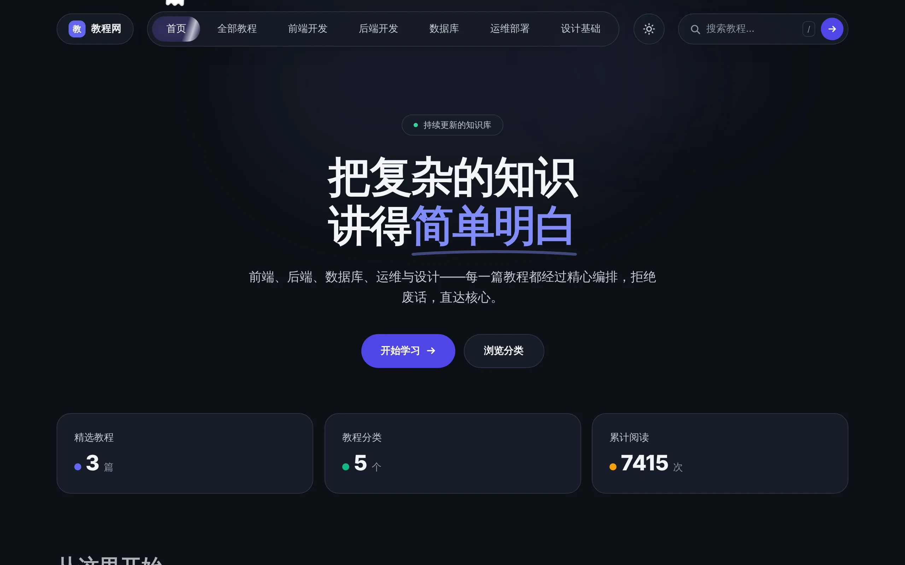
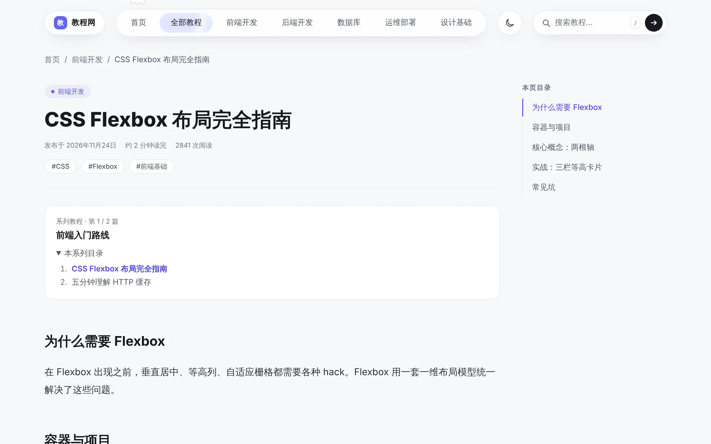
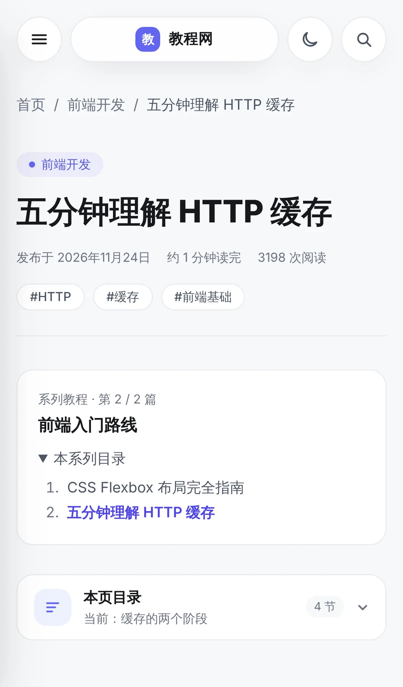
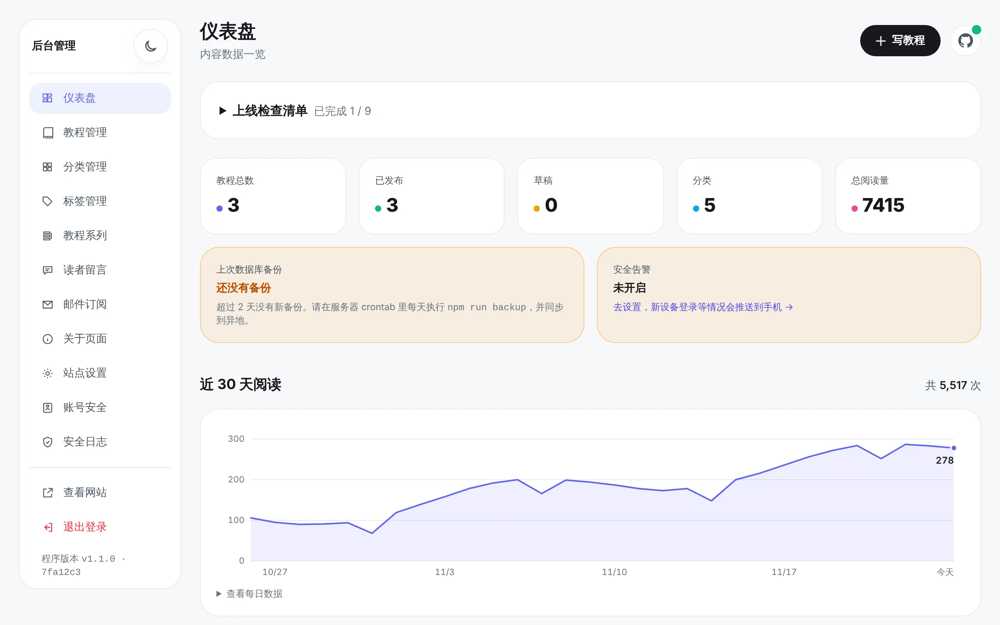
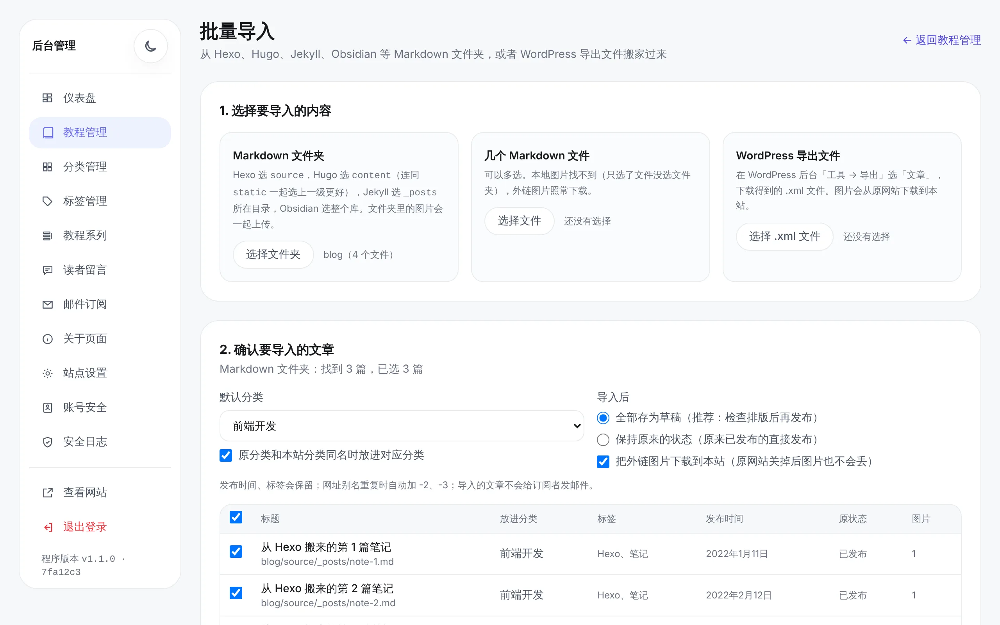

# 教程网

**简体中文** | [English](README.en.md) | [Русский](README.ru.md) | [日本語](README.ja.md)

开源的图文教程网站：前台阅读 + 后台写作、管理，一台服务器就能跑（SQLite，不需要另装数据库）。基于 Next.js 16、React 19、Tailwind CSS v4、Prisma 7。界面支持简体中文、English、Русский、日本語。

> **免责声明**：本站教程仅供个人合法学习研究，严禁用于违法、侵权等行为。用户使用内容产生的一切实操后果自行承担，与本站无关。本站不保证内容绝对无误，有权随时调整内容；如发现违规，我方保留配合调查的权利。访问本站即同意本声明。

## 预览

| 首页（亮色） | 首页（暗色） |
| --- | --- |
|  |  |

| 文章阅读（系列目录 + 本页目录） | 手机阅读 |
| --- | --- |
|  |  |

| 仪表盘 | 批量导入 |
| --- | --- |
|  |  |

## 功能

- **阅读**：亮暗主题跟随系统、文章目录、代码高亮和一键复制、图片放大、阅读进度、上下篇和相关教程、系列教程做成「教程书」（分章、读完打勾、继续阅读）、标签、全文搜索（中文 1–2 个字也能搜）、RSS、打印排版；低配设备自动关掉动效
- **写作**：富文本编辑器（拖拽/粘贴图片、表格、代码块、提示框）、自动保存草稿、历史版本、预览、定时发布、封面图、Markdown 导入导出、从 Hexo / Hugo / Jekyll / Obsidian / WordPress 批量搬家（保留时间、图片，生成旧地址跳转规则）、图片库
- **运营**：阅读趋势、热门教程、读完率、来源网站、读者搜了什么、「有帮助吗」反馈和读者留言、邮件订阅新教程、可选的第三方评论（Waline / Twikoo / Artalk / Giscus）、打赏码和赞助位
- **定制**：站名、Logo、网站图标、主题色、分享图、首页文案、导航链接、页脚、网站语言都在后台改，不用动代码；多人协作（站长 / 编辑 / 作者）
- **SEO**：sitemap、canonical、结构化数据、自动生成分享图、各搜索引擎站长验证
- **安全**：两步验证 + 恢复码、通行密钥、可吊销的会话、登录限流、正文白名单过滤、严格 CSP、安全日志和告警推送（钉钉 / 飞书 / 企业微信 / Telegram / Webhook）、加密备份、可选的 Cloudflare 人机验证和拒绝 AI 训练爬虫

## Docker 部署

推荐方式。需要 Docker 和 Docker Compose，服务器上不用装 Node、不用构建，镜像 `ghcr.io/vow132/tutorial-site` 支持 amd64 和 arm64：

```bash
git clone https://github.com/vow132/tutorial-site.git && cd tutorial-site
cp .env.example .env
# 编辑 .env：SITE_URL 改成正式地址，AUTH_SECRET 换成 openssl rand -base64 48 的输出
docker compose up -d
docker compose logs -f app     # 看到 Ready 就启动好了，日志里有安装地址和安装码
```

只需要 `docker-compose.yml` 和 `.env.example` 两个文件，不克隆仓库也行。

- 数据都在 `./docker-data/`（数据库、上传图片、备份），更新镜像、重建容器都不会丢。
- 端口只绑定 `127.0.0.1:3000`，前面用 Nginx / Caddy 配 HTTPS（见「安全加固」），并在 `.env` 里设 `TRUST_PROXY=true`。用示例 Nginx 配置时把 `/uploads/` 的 `alias` 改成 `…/docker-data/uploads/`。
- 改了 `.env` 后执行 `docker compose up -d` 生效；想固定版本就设 `TUTORIAL_IMAGE=ghcr.io/vow132/tutorial-site:<版本>`。
- 运维命令要以 `node` 用户在容器里执行：`docker compose exec -u node app npm run backup`（用 root 执行会让数据库文件变成 root 所有，网站就写不进去了）。
- 定时备份：宿主机 crontab 加 `17 3 * * * cd /path/to/tutorial-site && docker compose exec -T -u node app npm run backup`，再把 `docker-data` 同步到异地。

更新：`docker compose pull && docker compose up -d`。

改过代码或拉不到 ghcr.io 时自己构建：`docker compose -f docker-compose.yml -f docker-compose.build.yml up -d --build`（npm 默认走 npmmirror，Debian 软件包慢时设 `APT_MIRROR=mirrors.aliyun.com`）。Fork 后在自己仓库启用 Actions，每次推送 master 会自动构建 `ghcr.io/<你的用户名>/tutorial-site`。

## PM2 部署

需要 Node.js ≥ 22.12（推荐 24 LTS）、npm、PM2：

```bash
git clone https://github.com/vow132/tutorial-site.git && cd tutorial-site
cp .env.example .env.production   # 按里面的说明填写
bash deploy.sh                    # 安装依赖 → 迁移 → 种子数据 → 构建 → PM2 启动
```

以后再执行 `bash deploy.sh` 时，站点照常服务，只在迁移正式数据库的几秒内停站。

### 升级 Node.js

`node -v` 低于 22.12 时（以 nvm 为例）：

```bash
nvm install 24 && nvm alias default 24
npm install -g pm2                          # nvm 下每个 Node 版本的全局包是分开的
pm2 info 教程网 | grep "exec cwd"          # 找到正在运行的目录，cd 进去
npm rebuild better-sqlite3                  # 原生模块，换 Node 大版本后要重新编译
pm2 update                                  # PM2 改用新 Node 并恢复站点
```

### 一键更新

PM2 部署的站点可以在后台更新：仪表盘右上角圆点变黄表示有新版本，点它并再次输入密码即可。更新在独立进程里执行（下载 → 安装 → 对数据库副本迁移并构建 → 备份 → 切换 → 健康检查，失败自动回滚），切换时只中断几秒，不会运行种子数据。要求 Linux、单个 PM2 进程（默认名 `教程网`）、Git 部署且 `origin` 是本仓库、服务器能访问 GitHub 和 npm。设 `SITE_AUTO_UPDATE="false"` 可关闭。

第一次一键更新后 PM2 改用 `.updates/active.config.cjs` 启动，以后手动重启请用 `pm2 startOrReload .updates/active.config.cjs --update-env`。Fork 后改过代码的站点请按 [定制指南](docs/CUSTOMIZE.md) 手动合并更新。

## 首次安装

部署好后打开 `https://你的域名/admin`，会自动来到安装页：填安装码、站点名称、站长账号，选网站语言，可以保留示例教程看效果，也可以从空白开始。

安装码防止别人抢先注册站长，只出现在服务器的启动日志里（搜「安装码」或 `Setup code`）：`docker compose logs app` 或 `pm2 logs 教程网`；找不到时运行 `npm run setup:code`（Docker：`docker compose exec -u node app npm run setup:code`）。

也可以跳过安装页：部署前在环境变量里设 `ADMIN_USERNAME` 和 `ADMIN_PASSWORD`。

装好以后按仪表盘顶部的「上线检查清单」走一遍：改站名和品牌、清除示例数据、开两步验证、配备份。

## 环境变量

完整模板和说明见 [`.env.example`](.env.example)（Docker 用 `.env`，PM2 用 `.env.production`）。

| 变量 | 说明 |
| --- | --- |
| `SITE_URL` | **必填**，站点对外地址，如 `https://example.com` |
| `AUTH_SECRET` | **必填**，随机长字符串（`openssl rand -base64 48`）；没设或是示例里的占位值时后台拒绝登录 |
| `TRUST_PROXY` | 在 Nginx / Caddy 后面时设 `true`，才能拿到访客真实 IP；接在 Cloudflare 后面见「接入 Cloudflare」 |
| `ADMIN_USERNAME` / `ADMIN_PASSWORD` | 可选，第一次启动时直接建好站长账号 |
| `DATA_ENCRYPTION_KEY` | 可选，数据库敏感字段的加密密钥，不设时由 `AUTH_SECRET` 派生 |
| `BACKUP_PASSPHRASE` | 可选，备份加密口令（至少 12 位），务必另外保管 |
| `ALERT_TIMEZONE` | 可选，告警消息里的时区，默认 `Asia/Shanghai` |
| `DATABASE_URL` | PM2 部署的数据库位置，默认 `file:./prisma/dev.db` |

## 日常运维

Docker 部署在命令前加 `docker compose exec -u node app`。

| 命令 | 作用 |
| --- | --- |
| `npm run backup` | 在线备份数据库到 `backups/`（保留 14 份；设了 `BACKUP_PASSPHRASE` 时加密）。不要直接复制 `.db` 文件，WAL 模式下最新数据可能还在 `-wal` 里 |
| `npm run backup:restore -- <文件>` | 把备份解成独立的 `restored-….db` 并检查完整性，不动线上库，再按输出的步骤替换 |
| `npm run admin:reset` | 忘记密码时用：重置站长密码、关闭两步验证、删除通行密钥、退出所有设备、关闭人机验证；可加 `-- --username admin --password '新密码'` |
| `npm run uploads:clean` | 列出没被引用的上传图片，加 `-- --apply` 移到上传目录的 `.trash/`（后台「图片库」也能清理） |
| `npm run setup:code` | 再看一次首次安装的安装码 |
| `npm run images:variants` | 给老图片补生成响应式小图 |

`/api/health` 返回服务和数据库状态（正常 200，异常 503），可以接 Uptime Kuma 等做宕机告警。

## 安全加固（上线必做）

1. **HTTPS 反向代理，不要直接暴露 3000 端口。** 参考 [`deploy/nginx.conf.example`](deploy/nginx.conf.example)（HTTP 跳转 HTTPS、登录和搜索限流、公开页面缓存 1 分钟、更新期间返回缓存页而不是 502）。防火墙只放行 80/443，设置 `TRUST_PROXY="true"` 和 `SITE_URL="https://你的域名"`。
2. **定期异地备份。** crontab 每天执行 `npm run backup`，把备份和上传目录同步到另一台机器或对象存储（如 rclone），建议设 `BACKUP_PASSPHRASE` 加密。
3. **账号。** 用强密码，开两步验证（会给 10 个一次性恢复码）或通行密钥（需要 HTTPS + 域名访问）；GitHub 账号也开两步验证并保护 `master` 分支，因为一键更新部署的就是它。
4. **安全告警。** 后台「账号安全 → 安全告警」选钉钉、飞书、企业微信、Telegram 或 Webhook：新设备登录、登录被锁、改密码 / 两步验证 / 通行密钥、一键更新结果、备份失败或超过 2 天没备份时推送。
5. **漏洞报告入口。** 「站点设置 → 安全联系方式」填邮箱或网址，网站会提供 `/.well-known/security.txt`。
6. **依赖。** Dependabot 每周提交依赖更新，及时合并。

后台「安全日志」记录登录、改密、发布、上传、部署等操作，保留一年。

## 可选功能

### 多人协作

站长在「账号管理」给每个人开账号（初始密码随机生成、只显示一次）：

| 角色 | 能做什么 |
| --- | --- |
| 站长 | 全部，包括站点设置、账号管理、邮件订阅、安全日志、一键更新 |
| 编辑 | 所有教程、分类、标签、系列、关于页、读者留言、批量导入、图片库 |
| 作者 | 只能写、改、发布、删除自己的教程 |

文章页显示每个人在「账号安全」里填的署名，登录用户名不会出现在前台。

### 多语言

界面有简体中文、English、Русский、日本語四种：

- **网站语言**（「站点设置 → 网站语言」）：前台所有界面文字、RSS、邮件、告警消息用这种语言。换语言时，还是默认值的站名、首页文案、页脚会一起换成新语言的默认值，改过的保留。
- **后台语言**：每个管理员在侧栏底部（或登录页）自己选，存在自己的浏览器里，不影响别人和前台。
- **服务器上的命令**（备份、还原、重置管理员等）：中文站点输出中文，其余语言的站点输出英文；部署脚本和 Docker 启动日志中英文都写。

教程内容本身用什么语言写由你决定；示例教程是中文的，可以在仪表盘一键清除。

### 邮件订阅

需要一个 SMTP 发信服务（阿里云邮件推送、腾讯云 SES、企业邮箱等）。先在服务商那里验证发件域名并加好 SPF / DKIM，再在后台「邮件订阅」填 SMTP 信息、发测试邮件、勾选开启。读者双重确认后订阅，每篇新教程（含定时发布）只发一次，邮件里带一键退订。

### 评论

本站不存评论。在「站点设置 → 评论」选 Waline、Twikoo、Artalk（自己部署服务端）或 Giscus（GitHub Discussions），评论存在你自己的服务里。评论区在文末，读者滚到附近才加载。

### 图片加速

「站点设置 → 图片加速」填 CDN 或对象存储（阿里云 OSS 镜像回源、腾讯云 COS 回源）的域名，源站设为本站，点「测试」通过后保存。图片仍存在本站，不用搬文件，清空就恢复。

### 接入 Cloudflare

**人机验证（Turnstile）**：Cloudflare 控制台 → Turnstile → 添加小组件（模式选 Managed），把 Site Key 和 Secret Key 填进「站点设置 → 人机验证」，过一次验证后保存。之后密码登录、订阅、留言都要先过验证（通行密钥登录不需要）。网站不用接入 Cloudflare CDN 也能用。开启后万一登录不了，运行 `npm run admin:reset` 会同时关掉它。

**网站接在 Cloudflare 后面（橙色云朵）时，先把真实 IP 配好**，否则所有访客都像同几个 IP，登录限流会互相影响。二选一：

- 推荐：打开 [`deploy/nginx.conf.example`](deploy/nginx.conf.example) 里「接在 Cloudflare 后面时」那段（`real_ip_header CF-Connecting-IP` + [Cloudflare 的 IP 段](https://www.cloudflare.com/ips/)），`TRUST_PROXY="true"`；
- 没有 Nginx、Cloudflare 直连 Next：`TRUST_PROXY="cloudflare"`。

两种都要求防火墙只对 Cloudflare 的 IP 段放行 80/443；SSL/TLS 模式选 Full (strict)。上线检查清单会检查拿到的是不是真实 IP。

**防爬**：「站点设置 → 防爬」可以在 `robots.txt` 里拒绝 GPTBot、ClaudeBot、CCBot 等 AI 训练爬虫（搜索引擎照常收录），复制大段正文时附上来源。真正拦住批量抓取要在 Cloudflare 打开 Bot Fight Mode、「阻止 AI 机器人」，并加速率限制规则（如 `/tutorials/` 开头、同一 IP 10 秒超过 10 次 → 托管质询），Hotlink Protection 防盗链。不用 Cloudflare 的，Nginx 示例配置里有按 IP 限制文章页频率的写法。

### 演示站

想公开展示后台：单独部署一份，在 `.env` 里加上要公开的演示账号和 `DEMO_MODE="true"`：

```dotenv
ADMIN_USERNAME="demo"
ADMIN_PASSWORD="一个只用于演示站的密码"
DEMO_MODE="true"
```

演示模式下登录页填好账号，后台什么都能看，但保存、上传、删除、改密码、一键更新都不生效；读者留言、搜索词不入库，邮件订阅关闭，其他访客的 IP 打码。想换演示内容时先注释掉 `DEMO_MODE` 重启，改好再打开。**正式站不要开**，开了等于公开后台密码。

## 本地开发

```bash
npm ci
npx prisma generate
npx prisma migrate deploy
npx prisma db seed
npm run dev        # http://localhost:3000，后台 /admin，账号 admin / admin123456
```

测试：`npm test`（单元测试）；`npm run build && npm run test:e2e`（Playwright 端到端测试，会新建和删除 `e2e-` 开头的数据，只对开发数据库运行）。

## 文档

- [定制指南](docs/CUSTOMIZE.md)：后台能改什么、改代码动哪些文件、Fork 后怎么同步更新
- [CHANGELOG.md](CHANGELOG.md)：版本记录（后台侧栏底部显示正在运行的版本）
- [CONTRIBUTING.md](CONTRIBUTING.md)：参与开发
- [SECURITY.md](SECURITY.md)：私下报告安全问题
