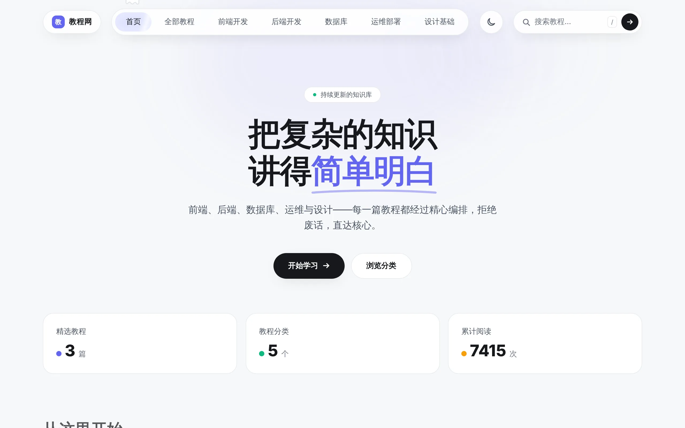
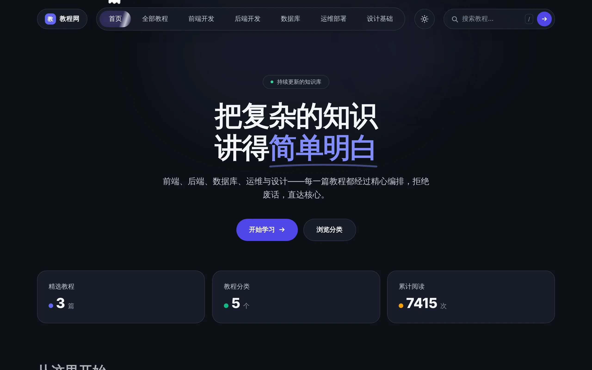
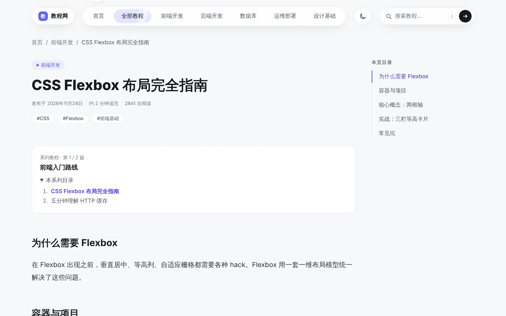
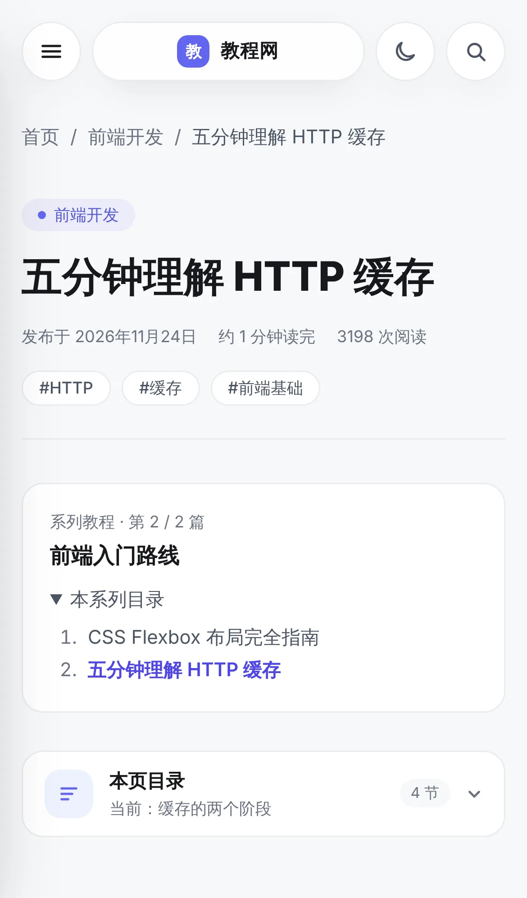
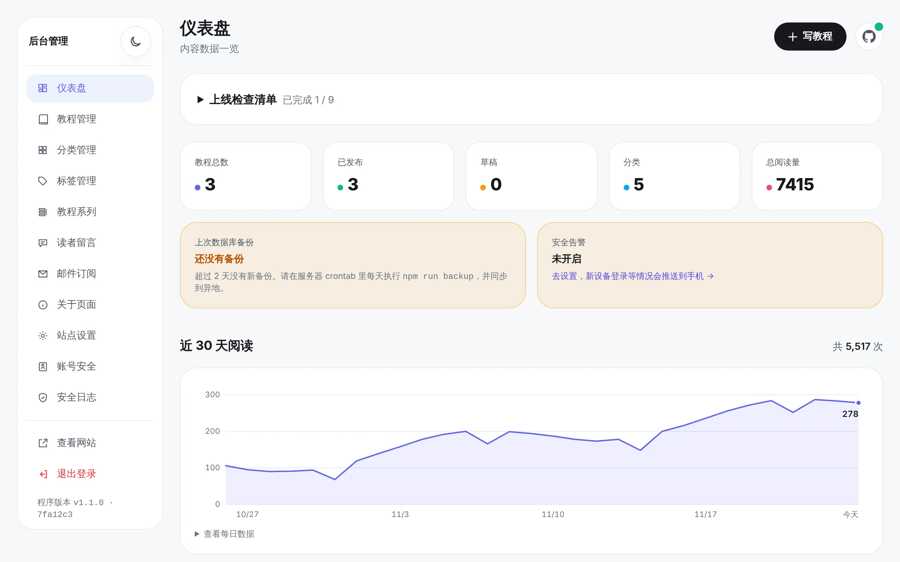
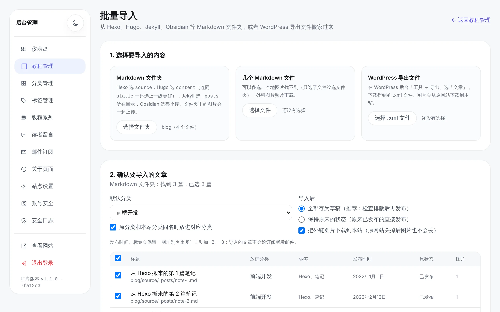

# Сайт уроков

[简体中文](README.md) | [English](README.en.md) | **Русский** | [日本語](README.ja.md)

Сайт с открытым исходным кодом для иллюстрированных уроков: публичная часть для чтения и админка для написания и управления. Работает на одном сервере (SQLite, отдельную базу данных ставить не нужно). Next.js 16, React 19, Tailwind CSS v4, Prisma 7. Интерфейс доступен на китайском (упрощённом), английском, русском и японском.

> **Отказ от ответственности**: уроки предназначены только для законного личного обучения и исследований и не должны использоваться для противоправных действий или нарушения чужих прав. Все последствия применения материалов несёт пользователь. Мы не гарантируем отсутствие ошибок и можем изменять материалы в любое время; при нарушениях мы оставляем за собой право содействовать расследованию. Посещая сайт, вы соглашаетесь с этим заявлением.

## Скриншоты

На скриншотах китайский интерфейс; язык сайта переключается в админке.

| Главная (светлая тема) | Главная (тёмная тема) |
| --- | --- |
|  |  |

| Статья (оглавление серии и страницы) | На телефоне |
| --- | --- |
|  |  |

| Панель | Массовый импорт |
| --- | --- |
|  |  |

## Возможности

- **Чтение**: светлая и тёмная тема по системной настройке, оглавление, подсветка кода и копирование в один клик, увеличение изображений, прогресс чтения, предыдущий/следующий и похожие уроки, серии в виде «книг» (главы, отметки о прочтении, «продолжить чтение»), теги, полнотекстовый поиск, RSS, вёрстка для печати; на слабых устройствах анимации отключаются
- **Написание**: визуальный редактор (перетаскивание и вставка изображений, таблицы, блоки кода, врезки), автосохранение черновиков, история версий, предпросмотр, отложенная публикация, обложки, импорт и экспорт Markdown, массовый перенос из Hexo / Hugo / Jekyll / Obsidian / WordPress (с датами, изображениями и правилами редиректа старых адресов), медиатека
- **Аудитория**: динамика просмотров, популярные уроки, доля дочитавших, источники переходов, что искали читатели, отзывы «Был ли урок полезен?» и сообщения читателей, подписка на новые уроки по почте, сторонние комментарии по желанию (Waline / Twikoo / Artalk / Giscus), QR-коды для пожертвований и место для спонсора
- **Настройка**: название, логотип, иконка, цвет акцента, картинка для соцсетей, тексты главной, ссылки в меню, подвал и язык сайта задаются в админке без правки кода; несколько авторов (владелец / редактор / автор)
- **SEO**: sitemap, канонические адреса, структурированные данные, автоматические картинки для соцсетей, подтверждение для поисковых систем
- **Безопасность**: двухфакторная аутентификация с кодами восстановления, ключи доступа (passkeys), отзываемые сессии, ограничение попыток входа, фильтрация HTML по белому списку, строгий CSP, журнал безопасности и оповещения (DingTalk / Feishu / WeCom / Telegram / Webhook), шифрованные резервные копии, по желанию проверка на робота от Cloudflare и запрет для ИИ-краулеров

## Развёртывание в Docker

Рекомендуемый способ. Нужны Docker и Docker Compose; Node и сборка на сервере не нужны. Образ `ghcr.io/vow132/tutorial-site` поддерживает amd64 и arm64:

```bash
git clone https://github.com/vow132/tutorial-site.git && cd tutorial-site
cp .env.example .env
# В .env: SITE_URL — публичный адрес сайта, AUTH_SECRET — вывод openssl rand -base64 48
docker compose up -d
docker compose logs -f app     # готово, когда появится Ready; в журнале есть адрес установки и код установки
```

Нужны только `docker-compose.yml` и `.env.example`, клонировать репозиторий не обязательно.

- Все данные лежат в `./docker-data/` (база, загруженные изображения, резервные копии) и сохраняются при обновлении образа и пересоздании контейнера.
- Порт привязан только к `127.0.0.1:3000`. Поставьте перед ним Nginx / Caddy с HTTPS (см. «Защита сайта») и задайте `TRUST_PROXY=true` в `.env`. С примером конфигурации Nginx поменяйте `alias` для `/uploads/` на `…/docker-data/uploads/`.
- После правки `.env` выполните `docker compose up -d`. Чтобы закрепить версию, задайте `TUTORIAL_IMAGE=ghcr.io/vow132/tutorial-site:<версия>`.
- Служебные команды запускайте в контейнере от пользователя `node`: `docker compose exec -u node app npm run backup` (от root файл базы станет принадлежать root, и сайт не сможет в него писать).
- Резервное копирование по расписанию: добавьте в crontab хоста `17 3 * * * cd /path/to/tutorial-site && docker compose exec -T -u node app npm run backup` и синхронизируйте `docker-data` на другой сервер.

Обновление: `docker compose pull && docker compose up -d`.

Если вы меняли код или ghcr.io недоступен, соберите образ сами: `docker compose -f docker-compose.yml -f docker-compose.build.yml up -d --build`. По умолчанию сборка использует зеркало npmmirror; если оно медленное, задайте `NPM_REGISTRY=https://registry.npmjs.org/` в `.env`. В форке включите Actions — каждый push в master соберёт `ghcr.io/<ваш-логин>/tutorial-site`.

## Развёртывание с PM2

Нужны Node.js ≥ 22.12 (рекомендуется 24 LTS), npm и PM2:

```bash
git clone https://github.com/vow132/tutorial-site.git && cd tutorial-site
cp .env.example .env.production   # заполните по комментариям в файле
bash deploy.sh                    # установка → миграции → начальные данные → сборка → запуск в PM2
```

Повторный запуск `bash deploy.sh` не останавливает сайт, кроме нескольких секунд на миграцию рабочей базы.

### Обновление Node.js

Если `node -v` ниже 22.12 (на примере nvm):

```bash
nvm install 24 && nvm alias default 24
npm install -g pm2                          # в nvm глобальные пакеты у каждой версии Node свои
pm2 info 教程网 | grep "exec cwd"          # найдите рабочий каталог и перейдите в него
npm rebuild better-sqlite3                  # нативный модуль, после смены мажорной версии Node его нужно пересобрать
pm2 update                                  # PM2 переходит на новый Node и восстанавливает сайт
```

### Обновление в один клик

Сайт на PM2 можно обновить из админки: точка в правом верхнем углу панели становится жёлтой, когда вышла новая версия; нажмите её и ещё раз введите пароль. Обновление идёт в отдельном процессе (загрузка → установка → миграция и сборка на копии базы → резервная копия → переключение → проверка работоспособности, при ошибке — автоматический откат); сайт недоступен лишь несколько секунд, начальные данные не загружаются. Требуется Linux, один процесс PM2 (по умолчанию `教程网`, меняется через `SITE_PM2_APP_NAME`), развёртывание через Git с `origin` на этот репозиторий и доступ к GitHub и npm. Отключается через `SITE_AUTO_UPDATE="false"`.

После первого обновления PM2 запускает сайт из `.updates/active.config.cjs`; перезапускайте вручную командой `pm2 startOrReload .updates/active.config.cjs --update-env`. Если вы сделали форк и меняли код, переносите обновления вручную по [руководству по настройке](docs/CUSTOMIZE.md) (на китайском).

## Первая установка

После развёртывания откройте `https://ваш-домен/admin` — откроется страница установки: введите код установки, название сайта и учётную запись владельца, выберите язык сайта. Можно оставить примеры уроков, чтобы посмотреть, как всё выглядит, или начать с пустого сайта.

Код установки не даёт никому зарегистрировать владельца раньше вас. Он есть только в журнале запуска сервера (ищите `Setup code`): `docker compose logs app` или `pm2 logs 教程网`. Если не нашли, выполните `npm run setup:code` (Docker: `docker compose exec -u node app npm run setup:code`).

Страницу установки можно пропустить, задав `ADMIN_USERNAME` и `ADMIN_PASSWORD` в переменных окружения до первого запуска.

Затем пройдите «Чек-лист запуска» вверху панели: смените название и оформление, удалите примеры, включите двухфакторную аутентификацию, настройте резервное копирование.

## Переменные окружения

Полный шаблон с комментариями — [`.env.example`](.env.example) (`.env` для Docker, `.env.production` для PM2).

| Переменная | Описание |
| --- | --- |
| `SITE_URL` | **Обязательно**. Публичный адрес, например `https://example.com` |
| `AUTH_SECRET` | **Обязательно**. Длинная случайная строка (`openssl rand -base64 48`); если не задана или осталась заглушкой из примера, вход в админку запрещён |
| `TRUST_PROXY` | `true` за Nginx / Caddy, чтобы видеть настоящие IP посетителей; за Cloudflare см. «Cloudflare» |
| `ADMIN_USERNAME` / `ADMIN_PASSWORD` | Необязательно. Создаёт владельца при первом запуске |
| `DATA_ENCRYPTION_KEY` | Необязательно. Ключ шифрования полей в базе; если не задан, выводится из `AUTH_SECRET` |
| `BACKUP_PASSPHRASE` | Необязательно. Пароль шифрования резервных копий (не короче 12 символов); храните копию отдельно |
| `ALERT_TIMEZONE` | Необязательно. Часовой пояс в оповещениях, по умолчанию `Asia/Shanghai` |
| `DATABASE_URL` | Расположение базы для PM2, по умолчанию `file:./prisma/dev.db` |

## Обслуживание

В Docker добавляйте перед командами `docker compose exec -u node app`.

| Команда | Что делает |
| --- | --- |
| `npm run backup` | Резервная копия базы «на ходу» в `backups/` (хранит 14; шифруется, если задан `BACKUP_PASSPHRASE`). Не копируйте `.db` напрямую: в режиме WAL свежие данные могут быть ещё в `-wal` |
| `npm run backup:restore -- <файл>` | Распаковывает копию в отдельный `restored-….db` и проверяет целостность, не трогая рабочую базу; дальше следуйте выведенным шагам |
| `npm run admin:reset` | Если забыли пароль: сбрасывает пароль владельца, отключает двухфакторную аутентификацию, удаляет ключи доступа, завершает все сессии и отключает проверку на робота; можно добавить `-- --username admin --password 'новый пароль'` |
| `npm run uploads:clean` | Показывает загруженные изображения, на которые ничто не ссылается; с `-- --apply` переносит их в `.trash/` в папке загрузок (то же умеет медиатека в админке) |
| `npm run setup:code` | Снова показывает код первой установки |
| `npm run images:variants` | Создаёт адаптивные размеры для старых изображений |

`/api/health` сообщает состояние сервиса и базы (200 — всё в порядке, 503 — проблема) для мониторинга вроде Uptime Kuma.

## Защита сайта (обязательно перед запуском)

1. **HTTPS через обратный прокси, не открывайте порт 3000.** См. [`deploy/nginx.conf.example`](deploy/nginx.conf.example) (переадресация HTTP → HTTPS, ограничения для входа и поиска, кэш публичных страниц на 1 минуту, во время обновления — страницы из кэша вместо ошибки 502). Откройте в брандмауэре только 80/443, задайте `TRUST_PROXY="true"` и `SITE_URL="https://ваш-домен"`.
2. **Регулярные резервные копии на другом сервере.** Запускайте `npm run backup` ежедневно через crontab и синхронизируйте копии и папку загрузок на другую машину или в объектное хранилище (например, rclone); рекомендуется задать `BACKUP_PASSPHRASE`.
3. **Учётные записи.** Надёжный пароль и двухфакторная аутентификация (вы получите 10 одноразовых кодов восстановления) или ключи доступа (нужны HTTPS и доменное имя). Защитите и аккаунт GitHub, и ветку `master`: именно её разворачивает обновление в один клик.
4. **Оповещения безопасности.** В админке «Безопасность аккаунта → Оповещения безопасности» выберите DingTalk, Feishu, WeCom, Telegram или webhook. Оповещения приходят о входе с нового устройства, блокировке входа, смене пароля / двухфакторной аутентификации / ключей доступа, результатах обновления, неудачных или просроченных (больше 2 дней) резервных копиях.
5. **Сообщения об уязвимостях.** Укажите email или адрес в «Настройки сайта → Контакт по безопасности», и сайт будет отдавать `/.well-known/security.txt`.
6. **Зависимости.** Dependabot каждую неделю предлагает обновления — принимайте их вовремя.

«Журнал безопасности» в админке хранит входы, смены пароля, публикации, загрузки, развёртывания и другое в течение года.

## Дополнительные возможности

### Несколько авторов

Владелец создаёт учётные записи в разделе «Учётные записи» (начальный пароль случайный и показывается один раз):

| Роль | Права |
| --- | --- |
| Владелец | Всё, включая настройки сайта, учётные записи, подписку по почте, журнал безопасности и обновления |
| Редактор | Все уроки, категории, теги, серии, страница «О сайте», сообщения читателей, массовый импорт и медиатека |
| Автор | Только свои уроки: писать, править, публиковать и удалять |

На странице статьи показывается подпись, которую каждый задаёт в «Безопасности аккаунта»; логины на публичном сайте не появляются.

### Языки

Интерфейс есть на китайском (упрощённом), английском, русском и японском:

- **Язык сайта** («Настройки сайта → Язык сайта»): на нём весь публичный интерфейс, RSS, письма и оповещения. При смене языка название сайта, тексты главной и подвал, если они остались по умолчанию, заменяются значениями по умолчанию нового языка; всё, что вы меняли, сохраняется.
- **Язык админки**: каждый администратор выбирает свой внизу боковой панели (или на странице входа). Он хранится в браузере и не влияет на других и на публичный сайт.

Язык самих уроков выбираете вы. Примеры уроков написаны на китайском, их можно удалить одним нажатием на панели.

### Подписка по почте

Нужен SMTP-сервис. Сначала подтвердите домен отправителя у провайдера и добавьте записи SPF / DKIM, затем заполните параметры SMTP в разделе «Подписка по почте», отправьте тестовое письмо и включите подписку. Читатели подтверждают подписку по почте; о каждом новом уроке (включая отложенные) письмо приходит один раз, с отпиской в один клик.

### Комментарии

Сайт не хранит комментарии сам. В «Настройки сайта → Комментарии» выберите Waline, Twikoo, Artalk (свой сервер) или Giscus (GitHub Discussions); комментарии хранятся в вашем сервисе. Блок комментариев в конце статьи загружается, только когда читатель до него докручивает.

### Ускорение изображений

В «Настройки сайта → Ускорение изображений» укажите домен CDN или объектного хранилища, которое берёт файлы с вашего сайта как с источника, нажмите «Проверить» и сохраните. Изображения остаются на сайте, переносить ничего не нужно; очистите поле, чтобы отключить.

### Cloudflare

**Проверка на робота (Turnstile)**: в панели Cloudflare откройте Turnstile → Add widget (режим Managed), введите Site Key и Secret Key в «Настройки сайта → Проверка на робота», пройдите проверку один раз и сохраните. После этого вход по паролю, подписка и сообщения читателей требуют проверки (вход по ключу доступа — нет). CDN Cloudflare для этого не нужен. Если после включения никто не может войти, `npm run admin:reset` отключит и её.

**Если сайт работает за Cloudflare (оранжевое облако), сначала настройте настоящие IP**, иначе все посетители выглядят как несколько адресов и ограничение входа действует на всех сразу. Выберите одно:

- Рекомендуется: включите блок «за Cloudflare» в [`deploy/nginx.conf.example`](deploy/nginx.conf.example) (`real_ip_header CF-Connecting-IP` и [диапазоны IP Cloudflare](https://www.cloudflare.com/ips/)) и оставьте `TRUST_PROXY="true"`;
- Без Nginx, Cloudflare подключается прямо к Next: `TRUST_PROXY="cloudflare"`.

В обоих случаях брандмауэр должен пускать на 80/443 только диапазоны Cloudflare; режим SSL/TLS — Full (strict). «Чек-лист запуска» проверяет, видит ли сайт настоящие IP.

**Парсинг**: «Настройки сайта → Защита от парсинга» может запретить в `robots.txt` ИИ-краулеры для обучения моделей — GPTBot, ClaudeBot, CCBot и другие (поисковики продолжают индексировать) — и добавлять источник при копировании длинных фрагментов. Чтобы по-настоящему остановить массовый парсинг, включите в Cloudflare Bot Fight Mode и «Block AI bots», добавьте правило ограничения частоты (например, пути с `/tutorials/`, больше 10 запросов с одного IP за 10 секунд → Managed Challenge) и Hotlink Protection. Без Cloudflare пример конфигурации Nginx показывает, как ограничить частоту запросов к статьям по IP.

### Демо-сайт

Чтобы публично показать админку, разверните отдельную копию и добавьте в `.env` публичную демо-учётку и `DEMO_MODE="true"`:

```dotenv
ADMIN_USERNAME="demo"
ADMIN_PASSWORD="пароль только для демо"
DEMO_MODE="true"
```

В демо-режиме форма входа заполнена, в админке можно смотреть всё, но сохранение, загрузка, удаление, смена пароля и обновления не срабатывают; сообщения читателей и поисковые запросы не сохраняются, подписка выключена, IP других посетителей скрыты. Чтобы поменять демо-контент, закомментируйте `DEMO_MODE`, перезапустите, внесите изменения и включите снова. **Не включайте его на рабочем сайте**: это раскрывает пароль админки.

## Локальная разработка

```bash
npm ci
npx prisma generate
npx prisma migrate deploy
npx prisma db seed
npm run dev        # http://localhost:3000, админка /admin, учётная запись admin / admin123456
```

Тесты: `npm test` (модульные); `npm run build && npm run test:e2e` (сквозные тесты Playwright; они создают и удаляют данные с префиксом `e2e-`, запускайте их только на базе для разработки).

## Документация

- [Руководство по настройке](docs/CUSTOMIZE.md) (на китайском): что меняется в админке, какие файлы править, как обновлять форк
- [CHANGELOG.md](CHANGELOG.md) (на китайском): история версий (текущая версия видна внизу боковой панели админки)
- [CONTRIBUTING.md](CONTRIBUTING.md) (на китайском): участие в разработке
- [SECURITY.md](SECURITY.md) (на китайском): как сообщить об уязвимости
